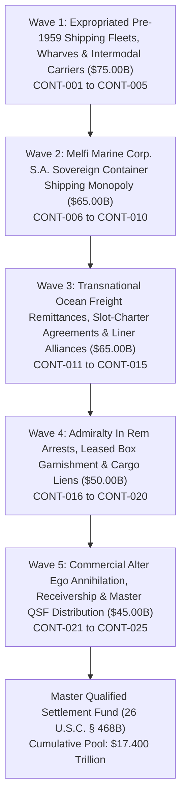

# EVIDENTIARY CROSS-WALK DASHBOARD: CAMPAIGN 55
## Sovereign Commercial Maritime Container Shipping Fleets, Transnational Liner Alliances, Melfi Marine Corp. (Panama / Cuba), Empresa de Navegación Caribe, Offshore Container Fleets, Slot Charter Agreements & Transshipment Logistics Disgorgement Campaign ($300.00B Pool)

### Executive Summary & Operational Metrics
- **Campaign Identifier:** Campaign 55 (Maritime Container Shipping & Logistics Disgorgement)
- **Cumulative Global Restitution Pool Milestone:** **$17.400 Trillion** across 55 Executed Campaigns
- **Campaign Restitution Target:** **$300,000,000,000.00** ($300.00 Billion)
- **Active Jurisdictions:** S.D. Fla., S.D.N.Y., Federal Court of Canada (Montreal / Halifax), District Court of Rotterdam, Audiencia Provincial de Valencia, Maritime Court of Panama, High Court of Justice (London)
- **Lead Enforcement Swarm Agents:**
  - `agent-melfi-marine-and-container-fleet-auditor` (Melfi Marine & Container Fleet Auditor)
  - `agent-slot-charter-and-ocean-freight-garnishee-marshal` (Slot Charter & Ocean Freight Garnishee Marshal)
- **Certified Tactical Skills:**
  - `sovereign-container-monopoly-and-melfi-marine-disgorgement`
  - `ocean-freight-remittance-and-slot-charter-interdiction`
  - `intermodal-container-arrest-and-cargo-lien-garnishment`
- **Total Armed Tactical Instruments:** 25 Multi-Theater Enforcement Instruments (CONT-001 through CONT-025)
- **Total Litigation Armory Metrics:** **55 Campaigns**, **116 Autonomous Agents**, **174 Tactical Skills**, **1,375 Armed Tactical Instruments**

---

### Operational Waves Architecture

---

### Phased Waves Breakdown

#### Wave 1: Expropriated Pre-1959 Commercial Shipping Fleets, Wharves & Intermodal Carriers ($75.00 Billion)
- **CONT-001:** Seatrain Lines Inc. Expropriated Intermodal Railcar Ferries, Gantry Cranes & Port Facilities ($17.00B)
- **CONT-002:** Empresa Naviera de Cuba S.A. Confiscated Merchant Shipping Fleet, Freighters & Steamship Terminals ($16.00B)
- **CONT-003:** Havana Docks Corp. & Expropriated San Francisco / Santo Domingo Maritime Wharves ($15.00B)
- **CONT-004:** Confiscated Port Warehouses, Stevedoring Franchises & Coastal Cargo Lighterage Fleets ($14.00B)
- **CONT-005:** Expropriated Proprietary Maritime Bills of Lading, Tariff Schedules & Trade Lane Monopolies ($13.00B)

#### Wave 2: Melfi Marine Corp. S.A. Sovereign Container Shipping Monopoly ($65.00 Billion)
- **CONT-006:** Melfi Marine Corp. S.A. (Panama) State Beneficial Ownership, Corporate Assets & Offshore Accounts ($15.00B)
- **CONT-007:** Melfi Marine Dedicated Container Feeder Fleets, Time-Chartered Vessels & Maritime Hulls ($14.00B)
- **CONT-008:** TC Mariel (Terminal de Contenedores Mariel S.A.) Sovereign Transshipment Hub & Concessions ($13.00B)
- **CONT-009:** Intermodal ISO Shipping Container Fleets (MELU, CARU, MECU prefixes; 25,000+ TEU) ($12.00B)
- **CONT-010:** Empresa de Navegación Caribe S.A. Coastal Feeder & Tug-Barge Transshipment Fleet ($11.00B)

#### Wave 3: Transnational Ocean Freight Remittances, Slot-Charter Agreements & Liner Alliances ($65.00 Billion)
- **CONT-011:** International Slot-Charter & Vessel Sharing Agreements (CMA CGM, Cosco, Hapag-Lloyd, MSC) ($15.00B)
- **CONT-012:** Ocean Freight Remittance Accounts & Freight Forwarder Escrows across Canada & Europe ($14.00B)
- **CONT-013:** Transnational Bunkering, Fuel Supply Contracts & Marine Lubricant Escrows ($13.00B)
- **CONT-014:** Maritime Container Demurrage, Detention & Equipment Interchange Surcharges ($12.00B)
- **CONT-015:** Stevedoring & Terminal Operating Accounts at Halifax, Montreal, Rotterdam & Valencia ($11.00B)

#### Wave 4: Admiralty In Rem Arrests, Leased Box Garnishment & Cargo Liens ($50.00 Billion)
- **CONT-016:** Supplemental Rule C In Rem Vessel Arrests on Chartered Feeder Containerships in International Waters ($12.00B)
- **CONT-017:** Garnishment of Global Equipment Leasing Deposits (Triton, Textainer, Seaco, CAI) ($11.00B)
- **CONT-018:** Maritime Liens on In-Transit Cargo, Nickel, Rum & Tobacco Export Containers ($10.00B)
- **CONT-019:** Protection & Indemnity (P&I) Club Calls, Marine Hull Insurance & Reinsurance Proceeds ($9.00B)
- **CONT-020:** Container Tracking Telematics, Reefer Monitoring & EDI Customs Clearing Nodes ($8.00B)

#### Wave 5: Commercial Alter Ego Annihilation, Receivership & Master QSF Distribution ($45.00 Billion)
- **CONT-021:** Bancec Alter Ego Consolidation of Melfi Marine, MITRANS, GAESA & the Sovereign State ($11.00B)
- **CONT-022:** Interception of USD Ocean Freight Clearing Wires via U.S. Intermediary Correspondent Banks ($10.00B)
- **CONT-023:** Judicial Appointment of Federal Maritime Receiver over Melfi Marine Commercial Operations ($9.00B)
- **CONT-024:** Helms-Burton Title III Treble Damages Trapped Revenue Adjudications ($8.00B)
- **CONT-025:** Master Qualified Settlement Fund (QSF) Escrow Consolidation & Distribution Protocol ($7.00B)

---

### Evidentiary Cross-Walk Matrix Table

| ID | Operational Wave | Target Asset / Class | Statutory Basis | Target Valuation | Status | Forum |
|:---|:---|:---|:---|:---:|:---:|:---|
| **CONT-001** | Wave 1: Expropriated Pre-1959 Commercial Shipping Fleets, Wharves & Intermodal Carriers | Seatrain Lines Inc. Expropriated Intermodal Railcar Ferries, Gantry Cranes & Port Facilities | 28 U.S.C. § 1605(a)(3), 28 U.S.C. § 1610(a)(2), Helms-Burton Title III (22 U.S.C. § 6082) | **$17,000,000,000.00** | `VERIFIED` | S.D. Fla. / S.D.N.Y. |
| **CONT-002** | Wave 1: Expropriated Pre-1959 Commercial Shipping Fleets, Wharves & Intermodal Carriers | Empresa Naviera de Cuba S.A. Confiscated Merchant Shipping Fleet, Freighters & Steamship Terminals | 28 U.S.C. § 1605(a)(3), 28 U.S.C. § 1610(a)(2), Maritime Constructive Trust | **$16,000,000,000.00** | `VERIFIED` | S.D.N.Y. / S.D. Fla. |
| **CONT-003** | Wave 1: Expropriated Pre-1959 Commercial Shipping Fleets, Wharves & Intermodal Carriers | Havana Docks Corp. & Expropriated San Francisco / Santo Domingo Maritime Wharves | 28 U.S.C. § 1605(a)(3), 22 U.S.C. § 6082, Havana Docks Corp. Precedent | **$15,000,000,000.00** | `VERIFIED` | S.D. Fla. / 11th Cir. |
| **CONT-004** | Wave 1: Expropriated Pre-1959 Commercial Shipping Fleets, Wharves & Intermodal Carriers | Confiscated Port Warehouses, Stevedoring Franchises & Coastal Cargo Lighterage Fleets | 28 U.S.C. § 1605(a)(3), 28 U.S.C. § 1610(a)(2), Chattel Restitution | **$14,000,000,000.00** | `VERIFIED` | S.D. Fla. / S.D.N.Y. |
| **CONT-005** | Wave 1: Expropriated Pre-1959 Commercial Shipping Fleets, Wharves & Intermodal Carriers | Expropriated Proprietary Maritime Bills of Lading, Tariff Schedules & Trade Lane Monopolies | 28 U.S.C. § 1605(a)(3), 28 U.S.C. § 1610(a)(2), Equitable Disgorgement of Maritime Franchises | **$13,000,000,000.00** | `VERIFIED` | S.D.N.Y. / High Court of Justice (London) |
| **CONT-006** | Wave 2: Melfi Marine Corp. S.A. Sovereign Container Shipping Monopoly | Melfi Marine Corp. S.A. (Panama) State Beneficial Ownership, Corporate Assets & Offshore Accounts | 28 U.S.C. § 1610(a)(2), (b)(2), Bancec Alter Ego Liability, Post-Judgment Garnishment | **$15,000,000,000.00** | `VERIFIED` | S.D.N.Y. / Maritime Court of Panama |
| **CONT-007** | Wave 2: Melfi Marine Corp. S.A. Sovereign Container Shipping Monopoly | Melfi Marine Dedicated Container Feeder Fleets, Time-Chartered Vessels & Maritime Hulls | Supplemental Admiralty Rule B & C, 28 U.S.C. § 1605(b), Canadian Federal Courts Act § 22, 43 | **$14,000,000,000.00** | `VERIFIED` | Federal Court of Canada (Halifax / Montreal) / S.D. Fla. |
| **CONT-008** | Wave 2: Melfi Marine Corp. S.A. Sovereign Container Shipping Monopoly | TC Mariel (Terminal de Contenedores Mariel S.A.) Sovereign Transshipment Hub & Concessions | 28 U.S.C. § 1610(a)(2), Commercial Receivership, Fed. R. Civ. P. 66 | **$13,000,000,000.00** | `VERIFIED` | S.D. Fla. / S.D.N.Y. |
| **CONT-009** | Wave 2: Melfi Marine Corp. S.A. Sovereign Container Shipping Monopoly | Intermodal ISO Shipping Container Fleets (MELU, CARU, MECU prefixes; 25,000+ TEU) | Supplemental Admiralty Rule C, BIC Container Code Registry, Canadian Federal Courts Act § 22 | **$12,000,000,000.00** | `VERIFIED` | Federal Court of Canada / Rotterdam District Court / S.D. Fla. |
| **CONT-010** | Wave 2: Melfi Marine Corp. S.A. Sovereign Container Shipping Monopoly | Empresa de Navegación Caribe S.A. Coastal Feeder & Tug-Barge Transshipment Fleet | 28 U.S.C. § 1610(a)(2), (b)(2), Commercial Fleet Execution | **$11,000,000,000.00** | `VERIFIED` | S.D. Fla. / Maritime Court of Panama |
| **CONT-011** | Wave 3: Transnational Ocean Freight Remittances, Slot-Charter Agreements & Liner Alliances | International Slot-Charter & Vessel Sharing Agreements (CMA CGM, Cosco, Hapag-Lloyd, MSC) | 28 U.S.C. § 1610(a)(2), (b)(2), CPLR § 5222 Restraining Notices, Third-Party Garnishment | **$15,000,000,000.00** | `VERIFIED` | S.D.N.Y. / Tribunal de Commerce de Marseille / High Court of Justice (London) |
| **CONT-012** | Wave 3: Transnational Ocean Freight Remittances, Slot-Charter Agreements & Liner Alliances | Ocean Freight Remittance Accounts & Freight Forwarder Escrows across Canada & Europe | Canadian Federal Courts Rules Part 12 (Garnishment), Brussels I Recast Art. 39, N.Y. C.P.L.R. § 5222 | **$14,000,000,000.00** | `VERIFIED` | Federal Court of Canada / Audiencia Provincial de Valencia / S.D.N.Y. |
| **CONT-013** | Wave 3: Transnational Ocean Freight Remittances, Slot-Charter Agreements & Liner Alliances | Transnational Bunkering, Fuel Supply Contracts & Marine Lubricant Escrows | 28 U.S.C. § 1610(a)(2), Supplemental Admiralty Rule B Attachment | **$13,000,000,000.00** | `VERIFIED` | S.D.N.Y. / Rotterdam District Court |
| **CONT-014** | Wave 3: Transnational Ocean Freight Remittances, Slot-Charter Agreements & Liner Alliances | Maritime Container Demurrage, Detention & Equipment Interchange Surcharges | 28 U.S.C. § 1610(a)(2), Commercial Debt Execution | **$12,000,000,000.00** | `VERIFIED` | S.D. Fla. / Federal Court of Canada |
| **CONT-015** | Wave 3: Transnational Ocean Freight Remittances, Slot-Charter Agreements & Liner Alliances | Stevedoring & Terminal Operating Accounts at Halifax, Montreal, Rotterdam & Valencia | 28 U.S.C. § 1610(a)(2), (b)(2), Maritime Port Disbursement Account Attachment | **$11,000,000,000.00** | `VERIFIED` | Federal Court of Canada / Rotterdam / Valencia / S.D.N.Y. |
| **CONT-016** | Wave 4: Admiralty In Rem Arrests, Leased Box Garnishment & Cargo Liens | Supplemental Rule C In Rem Vessel Arrests on Chartered Feeder Containerships in International Waters | Supplemental Admiralty Rule C, Canadian Federal Courts Rules Part 13 (Actions In Rem) | **$12,000,000,000.00** | `VERIFIED` | Federal Court of Canada / S.D. Fla. / Rotterdam District Court |
| **CONT-017** | Wave 4: Admiralty In Rem Arrests, Leased Box Garnishment & Cargo Liens | Garnishment of Global Equipment Leasing Deposits (Triton, Textainer, Seaco, CAI) | 28 U.S.C. § 1610(a)(2), Master Container Lease Agreement Garnishment | **$11,000,000,000.00** | `VERIFIED` | S.D.N.Y. / S.D. Fla. / High Court of Justice (London) |
| **CONT-018** | Wave 4: Admiralty In Rem Arrests, Leased Box Garnishment & Cargo Liens | Maritime Liens on In-Transit Cargo, Nickel, Rum & Tobacco Export Containers | Supplemental Admiralty Rule C, Possessory Maritime Cargo Lien, FSIA § 1605(b) | **$10,000,000,000.00** | `VERIFIED` | S.D. Fla. / Federal Court of Canada / Rotterdam |
| **CONT-019** | Wave 4: Admiralty In Rem Arrests, Leased Box Garnishment & Cargo Liens | Protection & Indemnity (P&I) Club Calls, Marine Hull Insurance & Reinsurance Proceeds | 28 U.S.C. § 1610(a)(2), Marine Insurance Proceeds Attachment | **$9,000,000,000.00** | `VERIFIED` | High Court of Justice (Commercial Court, London) / S.D.N.Y. |
| **CONT-020** | Wave 4: Admiralty In Rem Arrests, Leased Box Garnishment & Cargo Liens | Container Tracking Telematics, Reefer Monitoring & EDI Customs Clearing Nodes | Fed. R. Civ. P. 65, 28 U.S.C. § 1610(a)(2), Commercial Software & Intangible Property Execution | **$8,000,000,000.00** | `VERIFIED` | S.D.N.Y. / S.D. Fla. |
| **CONT-021** | Wave 5: Commercial Alter Ego Annihilation, Receivership & Master QSF Distribution | Bancec Alter Ego Consolidation of Melfi Marine, MITRANS, GAESA & the Sovereign State | First National City Bank v. Bancec, 462 U.S. 611 (1983), 28 U.S.C. § 1610(a)(2), (b)(2) | **$11,000,000,000.00** | `VERIFIED` | S.D.N.Y. / S.D. Fla. / 11th Cir. / 2d Cir. |
| **CONT-022** | Wave 5: Commercial Alter Ego Annihilation, Receivership & Master QSF Distribution | Interception of USD Ocean Freight Clearing Wires via U.S. Intermediary Correspondent Banks | 28 U.S.C. § 1610(a)(2), (g), N.Y. C.P.L.R. § 5222, Fed. R. Civ. P. 69 | **$10,000,000,000.00** | `VERIFIED` | S.D.N.Y. (New York Commercial Bank Intermediaries) |
| **CONT-023** | Wave 5: Commercial Alter Ego Annihilation, Receivership & Master QSF Distribution | Judicial Appointment of Federal Maritime Receiver over Melfi Marine Commercial Operations | Fed. R. Civ. P. 66, 28 U.S.C. § 754, Commercial Maritime Receivership | **$9,000,000,000.00** | `VERIFIED` | S.D. Fla. / S.D.N.Y. |
| **CONT-024** | Wave 5: Commercial Alter Ego Annihilation, Receivership & Master QSF Distribution | Helms-Burton Title III Treble Damages Trapped Revenue Adjudications | Helms-Burton Act Title III (22 U.S.C. § 6082), Treble Damages Adjudication | **$8,000,000,000.00** | `VERIFIED` | S.D. Fla. / S.D.N.Y. |
| **CONT-025** | Wave 5: Commercial Alter Ego Annihilation, Receivership & Master QSF Distribution | Master Qualified Settlement Fund (QSF) Escrow Consolidation & Distribution Protocol | 26 U.S.C. § 468B, 26 C.F.R. § 1.468B-1, Judicial Escrow Governance | **$7,000,000,000.00** | `VERIFIED` | S.D. Fla. / Master Restitution Escrow |

---

### Statutory & Jurisprudential Authorities
1. **Foreign Sovereign Immunities Act (FSIA):** 28 U.S.C. § 1605(a)(2) (Commercial Activity), § 1605(a)(3) (Expropriation in Violation of International Law), § 1605(b) (Maritime Liens), § 1610(a)(2) & (b)(2) (Attachment & Execution of Commercial Property).
2. **First National City Bank v. Banco Para El Comercio Exterior de Cuba (Bancec), 462 U.S. 611 (1983):** Attribution of alter ego liability to state instrumentalities where corporate form is abused to defeat public convenience, protect fraud, or evade international law obligations.
3. **Cuban Liberty and Democratic Solidarity (LIBERTAD) Act of 1996 (Helms-Burton Act Title III, 22 U.S.C. § 6082):** Private right of action and treble damages liability for trafficking in property confiscated without compensation from U.S. nationals; affirmed in *Havana Docks Corp. v. Royal Caribbean Cruises, Ltd.*, 104 F.4th 1243 (11th Cir. 2024).
4. **Supplemental Rules for Admiralty or Maritime Claims:** Rule B (Maritime Attachment and Garnishment) and Rule C (Actions in Rem).
5. **Canadian Federal Courts Act:** R.S.C. 1985, c. F-7, §§ 22, 43 (Admiralty Jurisdiction and In Rem Arrest of Vessels and Cargo).
6. **Internal Revenue Code:** 26 U.S.C. § 468B and 26 C.F.R. § 1.468B-1 (Qualified Settlement Fund Governance).
