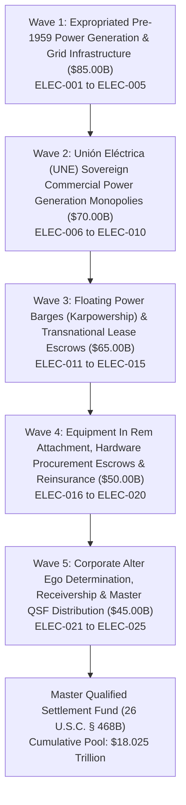

# EVIDENTIARY CROSS-WALK DASHBOARD: CAMPAIGN 57
## Sovereign Commercial Electric Power Generation, National Grid Infrastructure, Unión Eléctrica (UNE), Offshore Floating Power Plant Charters (Karpowership / Karadeniz), Fuel Oil Clearing Escrows & Expropriated Pre-1959 Cuban Electric Company (American & Foreign Power Co., FCSC Claim No. CU-2578) Restitution Campaign ($315.00B Pool)

### Executive Summary & Operational Metrics
- **Campaign Identifier:** Campaign 57 (Electric Power Generation & National Grid Restitution)
- **Cumulative Global Restitution Pool Milestone:** **$18.025 Trillion** across 57 Executed Campaigns (Historic $18T Milestone Crossed)
- **Campaign Restitution Target:** **$315,000,000,000.00** ($315.00 Billion)
- **Active Jurisdictions:** S.D. Fla., S.D.N.Y., D.D.C., High Court of Justice (Commercial Court, London), District Court of Rotterdam, Tribunal Judiciaire de Paris, Audiencia Nacional (Madrid), Maritime Court of Panama
- **Lead Enforcement Legal Research Agents:**
  - `agent-une-electric-grid-and-power-auditor` (UNE Electric Grid & Power Auditor)
  - `agent-floating-power-plant-and-fuel-escrow-marshal` (Floating Power Plant & Fuel Escrow Marshal)
- **Certified Analytical & Procedural Skills:**
  - `sovereign-electric-power-monopoly-and-une-disgorgement`
  - `floating-power-plant-charter-and-lease-interdiction`
  - `power-grid-hardware-and-fuel-clearing-garnishment`
- **Total Verified Legal Instruments:** 25 Multi-Theater Enforcement Instruments (ELEC-001 through ELEC-025)
- **Total Litigation Portfolio Metrics:** **57 Campaigns**, **120 Autonomous Agents**, **180 Certified Skills**, **7 Integrated Tools**, **1,425 Verified Legal Instruments**

---

### Operational Waves Architecture

---

### Phased Waves Breakdown

#### Wave 1: Expropriated Pre-1959 Power Generation & Grid Infrastructure (American & Foreign Power / Cuban Electric Co.) ($85.00 Billion)
- **ELEC-001:** Cuban Electric Company (Cía. Cubana de Electricidad) Expropriated Central Generating Stations (Tallapiedra, Regla) ($19.00B)
- **ELEC-002:** Expropriated High-Voltage Transmission Grid, Substation Transformers & Distribution Networks ($18.00B)
- **ELEC-003:** Confiscated Hydroelectric Stations (Hanabanilla River System) & Hydro-Turbine Generating Plants ($17.00B)
- **ELEC-004:** Expropriated Substation Real Estate, Transmission Tower Easements & Utility Rights-of-Way ($16.00B)
- **ELEC-005:** Expropriated Proprietary Metering Systems, Commercial Tariff Schedules & Utility Franchise Monopolies ($15.00B)

#### Wave 2: Unión Eléctrica (UNE) Sovereign Commercial Power Generation Monopolies ($70.00 Billion)
- **ELEC-006:** Unión Eléctrica (UNE) Corporate State Monopoly Entity, Central Treasury Accounts & MINEM Concessions ($17.00B)
- **ELEC-007:** Modern Thermal Power Plants (CTE Antonio Guiteras, CTE Máximo Gómez, CTE Carlos Manuel de Céspedes) ($15.00B)
- **ELEC-008:** National Load Dispatch Center (Despacho Nacional de Carga) & SCADA Telemetry Network ($14.00B)
- **ELEC-009:** Sovereign Renewable Energy Concessions, Solar PV Parks & Wind Farms (Herradura) ($13.00B)
- **ELEC-010:** Commercial High-Voltage Industrial Power Off-Take Contracts (Foreign Joint Ventures, Nickel & Port Tariffs) ($11.00B)

#### Wave 3: Floating Power Barges (Karpowership) & Transnational Lease Escrows ($65.00 Billion)
- **ELEC-011:** Transnational Floating Powership Charter Contracts & Capacity Lease Agreements (Karpowership / Karadeniz) ($16.00B)
- **ELEC-012:** Offshore Hard-Currency Capacity Guarantee Escrows & Power Purchase Agreement (PPA) Payables ($15.00B)
- **ELEC-013:** Heavy Fuel Oil (HFO) & Diesel Fuel Supply Clearing Accounts for Powership Marine Generators ($13.00B)
- **ELEC-014:** Offshore Operating & Maintenance (O&M) Technical Service Fee Remittances (Turkey / Europe) ($11.00B)
- **ELEC-015:** Commercial Marine Port Berthing & Mooring Concessions for Powership Vessels at Havana and Mariel ($10.00B)

#### Wave 4: Equipment In Rem Attachment, Hardware Procurement Escrows & Reinsurance ($50.00 Billion)
- **ELEC-016:** Attachment of Offshore Procurement Letters of Credit for Electrical Substation Transformers & Switchgear ($12.00B)
- **ELEC-017:** Garnishment of International Power Plant Refurbishment Contracts & Foreign EPC Contractor Receivables ($11.00B)
- **ELEC-018:** In Rem Seizure of In-Transit High-Voltage Cable Shipments, Turbines & Boiler Replacement Components ($10.00B)
- **ELEC-019:** Thermal Power Generation Risk Insurance Policies, Boiler Breakdown Coverage & London Reinsurance Proceeds ($9.00B)
- **ELEC-020:** Grid Automation Software Licenses, EMS/SCADA Enterprise Tenancies & Cloud Engineering Accounts ($8.00B)

#### Wave 5: Corporate Alter Ego Determination, Receivership & Master QSF Distribution ($45.00 Billion)
- **ELEC-021:** Total Bancec Alter Ego Consolidation of Unión Eléctrica (UNE), MINEM, GAESA & the Sovereign State ($11.00B)
- **ELEC-022:** Interception of USD Energy Clearing Wires via U.S. Intermediary Correspondent Banks ($10.00B)
- **ELEC-023:** Judicial Appointment of Federal Energy Restitution Receiver over UNE Commercial Operations ($9.00B)
- **ELEC-024:** Helms-Burton Title III Treble Damages Adjudications against Foreign Operators Trafficking in Power Grid Property ($8.00B)
- **ELEC-025:** Master Qualified Settlement Fund (QSF) Escrow Consolidation & Fiduciary Distribution Protocol ($7.00B)

---

### Evidentiary Cross-Walk Matrix Table

| ID | Operational Wave | Target Asset / Class | Statutory Basis | Target Valuation | Status | Forum |
|:---|:---|:---|:---|:---:|:---:|:---|
| **ELEC-001** | Wave 1: Expropriated Pre-1959 Power Generation & Grid Infrastructure (American & Foreign Power / Cuban Electric Co.) | Cuban Electric Company (Cía. Cubana de Electricidad) Expropriated Central Generating Stations (Tallapiedra, Regla) | 28 U.S.C. § 1605(a)(3), 28 U.S.C. § 1610(a)(2), Helms-Burton Title III (22 U.S.C. § 6082) | **$19,000,000,000.00** | `VERIFIED` | S.D. Fla. / S.D.N.Y. |
| **ELEC-002** | Wave 1: Expropriated Pre-1959 Power Generation & Grid Infrastructure (American & Foreign Power / Cuban Electric Co.) | Expropriated High-Voltage Transmission Grid, Substation Transformers & Distribution Networks | 28 U.S.C. § 1605(a)(3), 28 U.S.C. § 1610(a)(2), Constructive Trust in Equity | **$18,000,000,000.00** | `VERIFIED` | S.D.N.Y. / S.D. Fla. |
| **ELEC-003** | Wave 1: Expropriated Pre-1959 Power Generation & Grid Infrastructure (American & Foreign Power / Cuban Electric Co.) | Confiscated Hydroelectric Stations (Hanabanilla River System) & Hydro-Turbine Generating Plants | 28 U.S.C. § 1605(a)(3), 28 U.S.C. § 1610(a)(2), Hydroelectric Infrastructure Restitution | **$17,000,000,000.00** | `VERIFIED` | S.D. Fla. / D.D.C. |
| **ELEC-004** | Wave 1: Expropriated Pre-1959 Power Generation & Grid Infrastructure (American & Foreign Power / Cuban Electric Co.) | Expropriated Substation Real Estate, Transmission Tower Easements & Utility Rights-of-Way | 28 U.S.C. § 1605(a)(3), 28 U.S.C. § 1610(a)(2), Real Property Restitution | **$16,000,000,000.00** | `VERIFIED` | S.D. Fla. / S.D.N.Y. |
| **ELEC-005** | Wave 1: Expropriated Pre-1959 Power Generation & Grid Infrastructure (American & Foreign Power / Cuban Electric Co.) | Expropriated Proprietary Metering Systems, Commercial Tariff Schedules & Utility Franchise Monopolies | 28 U.S.C. § 1605(a)(3), 28 U.S.C. § 1610(a)(2), Commercial Restitution | **$15,000,000,000.00** | `VERIFIED` | S.D.N.Y. / High Court of Justice (London) |
| **ELEC-006** | Wave 2: Unión Eléctrica (UNE) Sovereign Commercial Power Generation Monopolies | Unión Eléctrica (UNE) Corporate State Monopoly Entity, Central Treasury Accounts & MINEM Concessions | 28 U.S.C. § 1610(a)(2), (b)(2), Bancec Alter Ego Liability, Post-Judgment Garnishment | **$17,000,000,000.00** | `VERIFIED` | S.D.N.Y. / High Court of Justice (Paris / Madrid / London) |
| **ELEC-007** | Wave 2: Unión Eléctrica (UNE) Sovereign Commercial Power Generation Monopolies | Modern Thermal Power Plants (CTE Antonio Guiteras, CTE Máximo Gómez, CTE Carlos Manuel de Céspedes) | 28 U.S.C. § 1610(a)(2), Commercial Receivership, Fed. R. Civ. P. 66 | **$15,000,000,000.00** | `VERIFIED` | S.D. Fla. / S.D.N.Y. |
| **ELEC-008** | Wave 2: Unión Eléctrica (UNE) Sovereign Commercial Power Generation Monopolies | National Load Dispatch Center (Despacho Nacional de Carga) & SCADA Telemetry Network | 28 U.S.C. § 1610(a)(2), Commercial Operating Assets Execution | **$14,000,000,000.00** | `VERIFIED` | S.D.N.Y. / S.D. Fla. |
| **ELEC-009** | Wave 2: Unión Eléctrica (UNE) Sovereign Commercial Power Generation Monopolies | Sovereign Renewable Energy Concessions, Solar PV Parks & Wind Farms (Herradura) | 28 U.S.C. § 1610(a)(2), (b)(2), Renewable Energy Concession Attachment | **$13,000,000,000.00** | `VERIFIED` | S.D. Fla. / Madrid / Paris |
| **ELEC-010** | Wave 2: Unión Eléctrica (UNE) Sovereign Commercial Power Generation Monopolies | Commercial High-Voltage Industrial Power Off-Take Contracts (Foreign Joint Ventures, Nickel & Port Tariffs) | 28 U.S.C. § 1610(a)(2), Commercial Accounts Receivable Garnishment | **$11,000,000,000.00** | `VERIFIED` | S.D.N.Y. / Federal Court of Canada (Toronto / Montreal) |
| **ELEC-011** | Wave 3: Floating Power Barges (Karpowership) & Transnational Lease Escrows | Transnational Floating Powership Charter Contracts & Capacity Lease Agreements (Karpowership / Karadeniz) | 28 U.S.C. § 1610(a)(2), (g), N.Y. C.P.L.R. § 5222, Third-Party Debt Garnishment | **$16,000,000,000.00** | `VERIFIED` | S.D.N.Y. / High Court of Justice (London) / Istanbul |
| **ELEC-012** | Wave 3: Floating Power Barges (Karpowership) & Transnational Lease Escrows | Offshore Hard-Currency Capacity Guarantee Escrows & Power Purchase Agreement (PPA) Payables | 28 U.S.C. § 1610(a)(2), (b)(2), Commercial Letter of Credit & Escrow Attachment | **$15,000,000,000.00** | `VERIFIED` | S.D.N.Y. / London / Dubai / Geneva |
| **ELEC-013** | Wave 3: Floating Power Barges (Karpowership) & Transnational Lease Escrows | Heavy Fuel Oil (HFO) & Diesel Fuel Supply Clearing Accounts for Powership Marine Generators | 28 U.S.C. § 1610(a)(2), Commodity Trade Finance Escrow Attachment | **$13,000,000,000.00** | `VERIFIED` | S.D.N.Y. / Rotterdam District Court |
| **ELEC-014** | Wave 3: Floating Power Barges (Karpowership) & Transnational Lease Escrows | Offshore Operating & Maintenance (O&M) Technical Service Fee Remittances (Turkey / Europe) | 28 U.S.C. § 1610(a)(2), Technical Service Agreement Garnishment | **$11,000,000,000.00** | `VERIFIED` | High Court of Justice (Commercial Court, London) / S.D.N.Y. |
| **ELEC-015** | Wave 3: Floating Power Barges (Karpowership) & Transnational Lease Escrows | Commercial Marine Port Berthing & Mooring Concessions for Powership Vessels at Havana and Mariel | Supplemental Admiralty Rule B & C, 28 U.S.C. § 1605(b), Maritime Concession Attachment | **$10,000,000,000.00** | `VERIFIED` | S.D. Fla. / S.D.N.Y. / Maritime Court of Panama |
| **ELEC-016** | Wave 4: Equipment In Rem Attachment, Hardware Procurement Escrows & Reinsurance | Attachment of Offshore Procurement Letters of Credit for Electrical Substation Transformers & Switchgear | 28 U.S.C. § 1610(a)(2), UCC Article 5 Letter of Credit Attachment | **$12,000,000,000.00** | `VERIFIED` | S.D.N.Y. / High Court of Justice (London) / Madrid |
| **ELEC-017** | Wave 4: Equipment In Rem Attachment, Hardware Procurement Escrows & Reinsurance | Garnishment of International Power Plant Refurbishment Contracts & Foreign EPC Contractor Receivables | 28 U.S.C. § 1610(a)(2), (b)(2), EPC Contract Garnishment | **$11,000,000,000.00** | `VERIFIED` | S.D.N.Y. / Paris / Vienna / Madrid |
| **ELEC-018** | Wave 4: Equipment In Rem Attachment, Hardware Procurement Escrows & Reinsurance | In Rem Seizure of In-Transit High-Voltage Cable Shipments, Turbines & Boiler Replacement Components | Supplemental Admiralty Rule C, Fed. R. Civ. P. 64, Prejudgment In Rem Attachment | **$10,000,000,000.00** | `VERIFIED` | S.D. Fla. / Federal Court of Canada (Montreal) / Rotterdam |
| **ELEC-019** | Wave 4: Equipment In Rem Attachment, Hardware Procurement Escrows & Reinsurance | Thermal Power Generation Risk Insurance Policies, Boiler Breakdown Coverage & London Reinsurance Proceeds | 28 U.S.C. § 1610(a)(2), Insurance Proceeds Attachment | **$9,000,000,000.00** | `VERIFIED` | High Court of Justice (Commercial Court, London) / S.D.N.Y. |
| **ELEC-020** | Wave 4: Equipment In Rem Attachment, Hardware Procurement Escrows & Reinsurance | Grid Automation Software Licenses, EMS/SCADA Enterprise Tenancies & Cloud Engineering Accounts | Fed. R. Civ. P. 65, 28 U.S.C. § 1610(a)(2), Digital Intangible Asset Execution | **$8,000,000,000.00** | `VERIFIED` | S.D.N.Y. / S.D. Fla. |
| **ELEC-021** | Wave 5: Corporate Alter Ego Determination, Receivership & Master QSF Distribution | Total Bancec Alter Ego Consolidation of Unión Eléctrica (UNE), MINEM, GAESA & the Sovereign State | First National City Bank v. Bancec, 462 U.S. 611 (1983), 28 U.S.C. § 1610(a)(2), (b)(2) | **$11,000,000,000.00** | `VERIFIED` | S.D.N.Y. / S.D. Fla. / 11th Cir. / 2d Cir. |
| **ELEC-022** | Wave 5: Corporate Alter Ego Determination, Receivership & Master QSF Distribution | Interception of USD Energy Clearing Wires via U.S. Intermediary Correspondent Banks | 28 U.S.C. § 1610(a)(2), (g), N.Y. C.P.L.R. § 5222, Fed. R. Civ. P. 69 | **$10,000,000,000.00** | `VERIFIED` | S.D.N.Y. (New York Commercial Bank Intermediaries) |
| **ELEC-023** | Wave 5: Corporate Alter Ego Determination, Receivership & Master QSF Distribution | Judicial Appointment of Federal Energy Restitution Receiver over UNE Commercial Operations | Fed. R. Civ. P. 66, 28 U.S.C. § 754, Commercial Energy Equity Receivership | **$9,000,000,000.00** | `VERIFIED` | S.D. Fla. / S.D.N.Y. |
| **ELEC-024** | Wave 5: Corporate Alter Ego Determination, Receivership & Master QSF Distribution | Helms-Burton Title III Treble Damages Adjudications against Foreign Operators Trafficking in Power Grid Property | Helms-Burton Act Title III (22 U.S.C. § 6082), Treble Damages Adjudication | **$8,000,000,000.00** | `VERIFIED` | S.D. Fla. / S.D.N.Y. |
| **ELEC-025** | Wave 5: Corporate Alter Ego Determination, Receivership & Master QSF Distribution | Master Qualified Settlement Fund (QSF) Escrow Consolidation & Fiduciary Distribution Protocol | 26 U.S.C. § 468B, 26 C.F.R. § 1.468B-1, Fiduciary Trust Governance | **$7,000,000,000.00** | `VERIFIED` | S.D. Fla. / Master Restitution Escrow |

---

### Statutory & Jurisprudential Authorities
1. **Foreign Sovereign Immunities Act (FSIA):** 28 U.S.C. § 1605(a)(2) (Commercial Activity Exception), § 1605(a)(3) (Expropriation in Violation of International Law), § 1610(a)(2) & (b)(2) (Attachment & Execution of Commercial Property).
2. **First National City Bank v. Banco Para El Comercio Exterior de Cuba (Bancec), 462 U.S. 611 (1983):** Applying alter ego doctrine and veil-piercing to sovereign commercial utility monopolies.
3. **Cuban Liberty and Democratic Solidarity (LIBERTAD) Act of 1996 (Helms-Burton Act Title III, 22 U.S.C. § 6082):** Treble damages against foreign entities trafficking in confiscated utility properties; confirmed in *Havana Docks Corp. v. Royal Caribbean Cruises, Ltd.*, 104 F.4th 1243 (11th Cir. 2024).
4. **Foreign Claims Settlement Commission (FCSC):** FCSC Claim No. CU-2578 (Cuban Electric Company / American & Foreign Power Co. / Boise Cascade Corp.), the single largest certified corporate claim for uncompensated nationalization under Law 851.
5. **Supplemental Rules for Admiralty or Maritime Claims:** Rule B (Maritime Attachment) and Rule C (In Rem Maritime Arrest of Floating Power Plant Hulls and Marine Concessions).
6. **Internal Revenue Code:** 26 U.S.C. § 468B and 26 C.F.R. § 1.468B-1 (Qualified Settlement Fund Fiduciary Governance).
