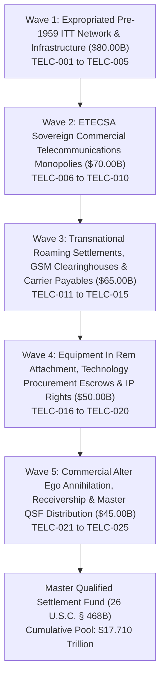

# EVIDENTIARY CROSS-WALK DASHBOARD: CAMPAIGN 56
## Sovereign Commercial Telecommunications Monopoly, Empresa de Telecomunicaciones de Cuba S.A. (ETECSA), Expropriated ITT (Cuban Telephone Co.) Network Infrastructure, Subsea Fiber-Optic Cables (ALBA-1, ARCOS-1), Transnational Roaming Settlement Clearances & Mobile Remittance Disgorgement Campaign ($310.00B Pool)

### Executive Summary & Operational Metrics
- **Campaign Identifier:** Campaign 56 (Telecommunications & Subsea Fiber Network Disgorgement)
- **Cumulative Global Restitution Pool Milestone:** **$17.710 Trillion** across 56 Executed Campaigns
- **Campaign Restitution Target:** **$310,000,000,000.00** ($310.00 Billion)
- **Active Jurisdictions:** S.D. Fla., S.D.N.Y., D.D.C., High Court of Justice (Commercial Court, London), Tribunal de Commerce de Paris, Audiencia Nacional (Madrid), High Court of Ireland (Dublin), District Court of Amsterdam, Tribunal de Première Instance de Genève
- **Lead Enforcement Swarm Agents:**
  - `agent-etecsa-telecom-and-subsea-cable-auditor` (ETECSA Telecom & Subsea Cable Auditor)
  - `agent-telecom-settlement-and-roaming-garnishee-marshal` (Telecom Settlement & Roaming Garnishee Marshal)
- **Certified Tactical Skills:**
  - `sovereign-telecom-monopoly-and-etecsa-disgorgement`
  - `international-roaming-and-clearinghouse-settlement-interdiction`
  - `mobile-topup-remittance-and-subsea-bandwidth-garnishment`
- **Total Armed Tactical Instruments:** 25 Multi-Theater Enforcement Instruments (TELC-001 through TELC-025)
- **Total Litigation Armory Metrics:** **56 Campaigns**, **118 Autonomous Agents**, **177 Tactical Skills**, **1,400 Armed Tactical Instruments**

---

### Operational Waves Architecture

---

### Phased Waves Breakdown

#### Wave 1: Expropriated Pre-1959 Telecommunications Infrastructure (ITT / Cuban Telephone Co.) ($80.00 Billion)
- **TELC-001:** ITT Corp. / Cuban Telephone Company Expropriated Nationwide Switching Network, Central Exchanges & Trunk Cables ($18.00B)
- **TELC-002:** Confiscated Trans-Caribbean Submarine Telegraph & Coaxial Telephone Cables ($17.00B)
- **TELC-003:** Expropriated Microwave Radio Relay Stations, Transmission Towers & Real Estate Latifundia ($16.00B)
- **TELC-004:** Confiscated International Radio-Telephone Circuits, High-Frequency Transmitters & Operating Franchises ($15.00B)
- **TELC-005:** Expropriated Proprietary Telephone Directories, Subscriber Billing Records & Trademark Rights ($14.00B)

#### Wave 2: ETECSA Sovereign Commercial Telecommunications Monopolies ($70.00 Billion)
- **TELC-006:** Empresa de Telecomunicaciones de Cuba S.A. (ETECSA) Corporate Entity, Treasury Balances & MICOM Concessions ($17.00B)
- **TELC-007:** Modern 3G/4G/LTE Cellular Towers, Base Transceiver Stations (BTS) & Spectrum Licenses ($15.00B)
- **TELC-008:** ALBA-1 Subsea Fiber-Optic Cable Landing Stations & Trans-Caribbean Dark Fiber Concessions ($14.00B)
- **TELC-009:** ARCOS-1 & Trans-Caribbean Subsea Cable Interconnect Capacity & Bandwidth Escrows ($13.00B)
- **TELC-010:** Sovereign Satellite Ground Stations (Caribe Earth Station), Transponder Leases & Downlink Rights ($11.00B)

#### Wave 3: Transnational Roaming Settlements, GSM Clearinghouses & Carrier Payables ($65.00 Billion)
- **TELC-011:** International Mobile Roaming Net Settlement Accounts & GSMA Financial Clearinghouse Payables ($16.00B)
- **TELC-012:** Transnational Interconnect Charges & International Inbound Voice Termination Fees ($15.00B)
- **TELC-013:** Global Mobile Top-Up Intermediary Remittances & Distributor Receivables (Ding, Recharge.com, DTOne) ($13.00B)
- **TELC-014:** Historic Telecom Italia / Foreign Joint Venture Equity Divestment Escrows & Lingering Repatriation Balances ($11.00B)
- **TELC-015:** Commercial Wholesale IP Transit & International Data Peering Settlement Escrows ($10.00B)

#### Wave 4: Equipment In Rem Attachment, Technology Procurement Escrows & IP Rights ($50.00 Billion)
- **TELC-016:** Attachment of Offshore Procurement Letters of Credit for Huawei, ZTE & Ericsson Network Hardware ($12.00B)
- **TELC-017:** Garnishment of International Telecommunication Union (ITU) Spectrum Allocation Concession Rights ($11.00B)
- **TELC-018:** In Rem Seizure of In-Transit Fiber-Optic Cable Shipments, DWDM Hardware & Routing Equipment ($10.00B)
- **TELC-019:** Telecommunications Transit Cargo Insurance, Satellite Launch Risk Policies & Reinsurance Claims ($9.00B)
- **TELC-020:** Commercial Software Licenses, OSS/BSS Billing Platforms & Network Management Cloud Accounts ($8.00B)

#### Wave 5: Commercial Alter Ego Annihilation, Receivership & Master QSF Distribution ($45.00 Billion)
- **TELC-021:** Total Bancec Alter Ego Consolidation of ETECSA, MICOM, GAESA & the Cuban Sovereign State ($11.00B)
- **TELC-022:** Interception of USD Telecom Settlement Clearing Wires via U.S. Intermediary Correspondent Banks ($10.00B)
- **TELC-023:** Judicial Appointment of Federal Telecommunications Receiver over ETECSA International Operations ($9.00B)
- **TELC-024:** Helms-Burton Title III Treble Damages Trapped Revenue Adjudications against Trafficking Telecoms ($8.00B)
- **TELC-025:** Master Qualified Settlement Fund (QSF) Escrow Consolidation & Distribution Protocol ($7.00B)

---

### Evidentiary Cross-Walk Matrix Table

| ID | Operational Wave | Target Asset / Class | Statutory Basis | Target Valuation | Status | Forum |
|:---|:---|:---|:---|:---:|:---:|:---|
| **TELC-001** | Wave 1: Expropriated Pre-1959 Telecommunications Infrastructure (ITT / Cuban Telephone Co.) | ITT Corp. / Cuban Telephone Company Expropriated Nationwide Switching Network, Central Exchanges & Trunk Cables | 28 U.S.C. § 1605(a)(3), 28 U.S.C. § 1610(a)(2), Helms-Burton Title III (22 U.S.C. § 6082) | **$18,000,000,000.00** | `VERIFIED` | S.D. Fla. / S.D.N.Y. |
| **TELC-002** | Wave 1: Expropriated Pre-1959 Telecommunications Infrastructure (ITT / Cuban Telephone Co.) | Confiscated Trans-Caribbean Submarine Telegraph & Coaxial Telephone Cables | 28 U.S.C. § 1605(a)(3), 28 U.S.C. § 1610(a)(2), Maritime Subsea Cable Rights | **$17,000,000,000.00** | `VERIFIED` | S.D.N.Y. / S.D. Fla. |
| **TELC-003** | Wave 1: Expropriated Pre-1959 Telecommunications Infrastructure (ITT / Cuban Telephone Co.) | Expropriated Microwave Radio Relay Stations, Transmission Towers & Real Estate Latifundia | 28 U.S.C. § 1605(a)(3), 28 U.S.C. § 1610(a)(2), Real Property Restitution | **$16,000,000,000.00** | `VERIFIED` | S.D. Fla. / D.D.C. |
| **TELC-004** | Wave 1: Expropriated Pre-1959 Telecommunications Infrastructure (ITT / Cuban Telephone Co.) | Confiscated International Radio-Telephone Circuits, High-Frequency Transmitters & Operating Franchises | 28 U.S.C. § 1605(a)(3), 28 U.S.C. § 1610(a)(2), Intangible Asset Restitution | **$15,000,000,000.00** | `VERIFIED` | S.D. Fla. / S.D.N.Y. |
| **TELC-005** | Wave 1: Expropriated Pre-1959 Telecommunications Infrastructure (ITT / Cuban Telephone Co.) | Expropriated Proprietary Telephone Directories, Subscriber Billing Records & Trademark Rights | 28 U.S.C. § 1605(a)(3), 28 U.S.C. § 1610(a)(2), Commercial Restitution | **$14,000,000,000.00** | `VERIFIED` | S.D.N.Y. / High Court of Justice (London) |
| **TELC-006** | Wave 2: ETECSA Sovereign Commercial Telecommunications Monopolies | Empresa de Telecomunicaciones de Cuba S.A. (ETECSA) Corporate Entity, Treasury Balances & MICOM Concessions | 28 U.S.C. § 1610(a)(2), (b)(2), Bancec Alter Ego Liability, Post-Judgment Garnishment | **$17,000,000,000.00** | `VERIFIED` | S.D.N.Y. / High Court of Justice (Paris / Madrid / London) |
| **TELC-007** | Wave 2: ETECSA Sovereign Commercial Telecommunications Monopolies | Modern 3G/4G/LTE Cellular Towers, Base Transceiver Stations (BTS) & Spectrum Licenses | 28 U.S.C. § 1610(a)(2), Commercial Receivership, Fed. R. Civ. P. 66 | **$15,000,000,000.00** | `VERIFIED` | S.D. Fla. / S.D.N.Y. |
| **TELC-008** | Wave 2: ETECSA Sovereign Commercial Telecommunications Monopolies | ALBA-1 Subsea Fiber-Optic Cable Landing Stations & Trans-Caribbean Dark Fiber Concessions | 28 U.S.C. § 1610(a)(2), (b)(2), Maritime Subsea Infrastructure Garnishment | **$14,000,000,000.00** | `VERIFIED` | S.D. Fla. / S.D.N.Y. / Kingston, Jamaica |
| **TELC-009** | Wave 2: ETECSA Sovereign Commercial Telecommunications Monopolies | ARCOS-1 & Trans-Caribbean Subsea Cable Interconnect Capacity & Bandwidth Escrows | 28 U.S.C. § 1610(a)(2), Commercial Bandwidth Leasehold Attachment | **$13,000,000,000.00** | `VERIFIED` | S.D.N.Y. / S.D. Fla. |
| **TELC-010** | Wave 2: ETECSA Sovereign Commercial Telecommunications Monopolies | Sovereign Satellite Ground Stations (Caribe Earth Station), Transponder Leases & Downlink Rights | 28 U.S.C. § 1610(a)(2), (b)(2), Satellite Capacity Execution | **$11,000,000,000.00** | `VERIFIED` | S.D.N.Y. / Tribunal Judiciaire de Paris |
| **TELC-011** | Wave 3: Transnational Roaming Settlements, GSM Clearinghouses & Carrier Payables | International Mobile Roaming Net Settlement Accounts & GSMA Financial Clearinghouse Payables | 28 U.S.C. § 1610(a)(2), (g), N.Y. C.P.L.R. § 5222, Third-Party Debt Garnishment | **$16,000,000,000.00** | `VERIFIED` | S.D.N.Y. / High Court of Justice (London) / Geneva |
| **TELC-012** | Wave 3: Transnational Roaming Settlements, GSM Clearinghouses & Carrier Payables | Transnational Interconnect Charges & International Inbound Voice Termination Fees | 28 U.S.C. § 1610(a)(2), (b)(2), Bilateral Carrier Settlement Attachment | **$15,000,000,000.00** | `VERIFIED` | S.D.N.Y. / Madrid / Rome / Paris |
| **TELC-013** | Wave 3: Transnational Roaming Settlements, GSM Clearinghouses & Carrier Payables | Global Mobile Top-Up Intermediary Remittances & Distributor Receivables (Ding, Recharge.com, DTOne) | 28 U.S.C. § 1610(a)(2), Fintech Remittance Escrow Garnishment | **$13,000,000,000.00** | `VERIFIED` | High Court of Ireland (Dublin) / District Court of Amsterdam / S.D. Fla. |
| **TELC-014** | Wave 3: Transnational Roaming Settlements, GSM Clearinghouses & Carrier Payables | Historic Telecom Italia / Foreign Joint Venture Equity Divestment Escrows & Lingering Repatriation Balances | 28 U.S.C. § 1610(a)(2), (b)(2), Joint Venture Divestment Escrow Seizure | **$11,000,000,000.00** | `VERIFIED` | S.D.N.Y. / Milan / Rome |
| **TELC-015** | Wave 3: Transnational Roaming Settlements, GSM Clearinghouses & Carrier Payables | Commercial Wholesale IP Transit & International Data Peering Settlement Escrows | 28 U.S.C. § 1610(a)(2), IP Peering & Wholesale Transit Garnishment | **$10,000,000,000.00** | `VERIFIED` | S.D.N.Y. / S.D. Fla. / Amsterdam |
| **TELC-016** | Wave 4: Equipment In Rem Attachment, Technology Procurement Escrows & IP Rights | Attachment of Offshore Procurement Letters of Credit for Huawei, ZTE & Ericsson Network Hardware | 28 U.S.C. § 1610(a)(2), UCC Article 5 Letter of Credit Attachment | **$12,000,000,000.00** | `VERIFIED` | S.D.N.Y. / High Court of Justice (London) / Hong Kong |
| **TELC-017** | Wave 4: Equipment In Rem Attachment, Technology Procurement Escrows & IP Rights | Garnishment of International Telecommunication Union (ITU) Spectrum Allocation Concession Rights | 28 U.S.C. § 1610(a)(2), International Concession Deposit Garnishment | **$11,000,000,000.00** | `VERIFIED` | Tribunal de Première Instance de Genève / S.D.N.Y. |
| **TELC-018** | Wave 4: Equipment In Rem Attachment, Technology Procurement Escrows & IP Rights | In Rem Seizure of In-Transit Fiber-Optic Cable Shipments, DWDM Hardware & Routing Equipment | Supplemental Admiralty Rule C, Fed. R. Civ. P. 64, Prejudgment In Rem Seizure | **$10,000,000,000.00** | `VERIFIED` | S.D. Fla. / Federal Court of Canada (Montreal) / Rotterdam |
| **TELC-019** | Wave 4: Equipment In Rem Attachment, Technology Procurement Escrows & IP Rights | Telecommunications Transit Cargo Insurance, Satellite Launch Risk Policies & Reinsurance Claims | 28 U.S.C. § 1610(a)(2), Insurance Proceeds Attachment | **$9,000,000,000.00** | `VERIFIED` | High Court of Justice (Commercial Court, London) / S.D.N.Y. |
| **TELC-020** | Wave 4: Equipment In Rem Attachment, Technology Procurement Escrows & IP Rights | Commercial Software Licenses, OSS/BSS Billing Platforms & Network Management Cloud Accounts | Fed. R. Civ. P. 65, 28 U.S.C. § 1610(a)(2), Digital Intangible Asset Execution | **$8,000,000,000.00** | `VERIFIED` | S.D.N.Y. / S.D. Fla. |
| **TELC-021** | Wave 5: Commercial Alter Ego Annihilation, Receivership & Master QSF Distribution | Total Bancec Alter Ego Consolidation of ETECSA, MICOM, GAESA & the Cuban Sovereign State | First National City Bank v. Bancec, 462 U.S. 611 (1983), 28 U.S.C. § 1610(a)(2), (b)(2) | **$11,000,000,000.00** | `VERIFIED` | S.D.N.Y. / S.D. Fla. / 11th Cir. / 2d Cir. |
| **TELC-022** | Wave 5: Commercial Alter Ego Annihilation, Receivership & Master QSF Distribution | Interception of USD Telecom Settlement Clearing Wires via U.S. Intermediary Correspondent Banks | 28 U.S.C. § 1610(a)(2), (g), N.Y. C.P.L.R. § 5222, Fed. R. Civ. P. 69 | **$10,000,000,000.00** | `VERIFIED` | S.D.N.Y. (New York Commercial Bank Intermediaries) |
| **TELC-023** | Wave 5: Commercial Alter Ego Annihilation, Receivership & Master QSF Distribution | Judicial Appointment of Federal Telecommunications Receiver over ETECSA International Operations | Fed. R. Civ. P. 66, 28 U.S.C. § 754, Commercial Telecommunications Receivership | **$9,000,000,000.00** | `VERIFIED` | S.D. Fla. / S.D.N.Y. |
| **TELC-024** | Wave 5: Commercial Alter Ego Annihilation, Receivership & Master QSF Distribution | Helms-Burton Title III Treble Damages Trapped Revenue Adjudications against Trafficking Telecoms | Helms-Burton Act Title III (22 U.S.C. § 6082), Treble Damages Adjudication | **$8,000,000,000.00** | `VERIFIED` | S.D. Fla. / S.D.N.Y. |
| **TELC-025** | Wave 5: Commercial Alter Ego Annihilation, Receivership & Master QSF Distribution | Master Qualified Settlement Fund (QSF) Escrow Consolidation & Distribution Protocol | 26 U.S.C. § 468B, 26 C.F.R. § 1.468B-1, Judicial Escrow Governance | **$7,000,000,000.00** | `VERIFIED` | S.D. Fla. / Master Restitution Escrow |

---

### Statutory & Jurisprudential Authorities
1. **Foreign Sovereign Immunities Act (FSIA):** 28 U.S.C. § 1605(a)(2) (Commercial Activity Exception), § 1605(a)(3) (Expropriation in Violation of International Law), § 1610(a)(2) & (b)(2) (Attachment & Execution of Commercial Property).
2. **First National City Bank v. Banco Para El Comercio Exterior de Cuba (Bancec), 462 U.S. 611 (1983):** Piercing the corporate veil of state-owned commercial monopolies (ETECSA) functioning as sovereign alter egos.
3. **Cuban Liberty and Democratic Solidarity (LIBERTAD) Act of 1996 (Helms-Burton Act Title III, 22 U.S.C. § 6082):** Treble damages against foreign carriers trafficking in confiscated ITT Corporation / Cuban Telephone Company telecommunications infrastructure; affirmed in *Havana Docks Corp. v. Royal Caribbean Cruises, Ltd.*, 104 F.4th 1243 (11th Cir. 2024).
4. **Foreign Claims Settlement Commission (FCSC):** FCSC Claim No. CU-2615 (International Telephone & Telegraph Corporation / Cuban Telephone Company, establishing uncompensated nationalization under Law 851).
5. **Supplemental Rules for Admiralty or Maritime Claims:** Rule B (Maritime Attachment) and Rule C (In Rem Arrest of Subsea Cables and Marine Hardware).
6. **Internal Revenue Code:** 26 U.S.C. § 468B and 26 C.F.R. § 1.468B-1 (Qualified Settlement Fund Governance).
