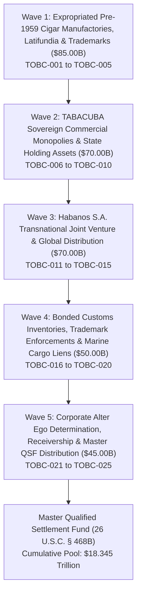

# EVIDENTIARY CROSS-WALK DASHBOARD: CAMPAIGN 58
## Sovereign Commercial Premium Tobacco Agro-Industrial Monopolies, Grupo Empresarial de Tabaco de Cuba (TABACUBA), Habanos S.A. Transnational Joint Venture, Worldwide Cigar Export Consignments, Royalties & Expropriated Pre-1959 Cigar Manufactories and Trademarks (Menéndez García / Cifuentes / Dunhill Precedents) Restitution Campaign ($320.00B Pool)

### Executive Summary & Operational Metrics
- **Campaign Identifier:** Campaign 58 (Premium Tobacco & Cigar Monopolies Restitution)
- **Cumulative Global Restitution Pool Milestone:** **$18.345 Trillion** across 58 Executed Campaigns
- **Campaign Restitution Target:** **$320,000,000,000.00** ($320.00 Billion)
- **Active Jurisdictions:** S.D. Fla., S.D.N.Y., D.D.C., High Court of Justice (Commercial Court, London), Juzgados de Primera Instancia de Madrid, Cour de Justice de Genève, Rechtbank Rotterdam, High Court of Hong Kong
- **Lead Enforcement Legal Research Agents:**
  - `agent-tabacuba-and-cigar-monopoly-auditor` (TABACUBA & Cigar Monopoly Auditor)
  - `agent-habanos-jv-and-cigar-distributor-marshal` (Habanos JV & Cigar Distributor Marshal)
- **Certified Analytical & Procedural Skills:**
  - `sovereign-tobacco-monopoly-and-tabacuba-disgorgement`
  - `habanos-joint-venture-and-dividend-interdiction`
  - `premium-cigar-cargo-arrest-and-distributor-garnishment`
- **Total Verified Legal Instruments:** 25 Multi-Theater Enforcement Instruments (TOBC-001 through TOBC-025)
- **Total Litigation Portfolio Metrics:** **58 Campaigns**, **122 Autonomous Agents**, **183 Certified Skills**, **7 Integrated Tools**, **1,450 Verified Legal Instruments**

---

### Operational Waves Architecture

---

### Phased Waves Breakdown

#### Wave 1: Expropriated Pre-1959 Cigar Manufactories, Latifundia & Trademarks ($85.00 Billion)
- **TOBC-001:** Menéndez, García y Cía. Expropriated H. Upmann Factory, Montecristo Brand Assets & Leaf Warehouses ($19.00B)
- **TOBC-002:** Cifuentes y Cía. Expropriated Real Fábrica de Tabacos Partagás (Havana Industrial Compound) ($18.00B)
- **TOBC-003:** Francisco Palicio y Cía. Confiscated Hoyo de Monterrey & Punch Cigar Factories and Vega Concessions ($17.00B)
- **TOBC-004:** Expropriated Vuelta Abajo Shade-Grown Wrapper Leaf Vega Latifundia & Curing Barns (Pinar del Río) ($16.00B)
- **TOBC-005:** Expropriated Proprietary Blending Formulas, Master Roller Guild Lineages & Trademark Goodwill ($15.00B)

#### Wave 2: TABACUBA Sovereign Commercial Monopolies & State Holding Assets ($70.00 Billion)
- **TOBC-006:** Grupo Empresarial de Tabaco de Cuba (TABACUBA) Corporate Entity, Central Accounts & MINAG Concessions ($17.00B)
- **TOBC-007:** Modern Centralized Cigar Manufacturing Combine at El Laguito (Cohiba Production Facility) ($15.00B)
- **TOBC-008:** Empresa de Acopio y Beneficio de Tabaco Regional Processing & Fermentation Centers ($14.00B)
- **TOBC-009:** National Cigarette Manufacturing Combine (Brascuba Cigarrillos S.A. Joint Venture with Souza Cruz) ($13.00B)
- **TOBC-010:** Commercial La Casa del Habano (LCDH) Worldwide Franchise Network, Royalty Fees & Retail Concessions ($11.00B)

#### Wave 3: Habanos S.A. Transnational Joint Venture (Allied Cigar Corp / Imperial Brands) & Global Distribution ($70.00 Billion)
- **TOBC-011:** Habanos S.A. 50/50 Sovereign Equity Holding, Transnational Board Rights & Operating Reserves ($18.00B)
- **TOBC-012:** Allied Cigar Corp / Tabacalera S.L.U. Annual Dividend Remittances & Offshore Holding Accounts (Spain / HK) ($16.00B)
- **TOBC-013:** Exclusive European Master Distributor Receivables (Hunters & Frankau, 5th Avenue, Diadema, Coprova) ($14.00B)
- **TOBC-014:** Middle East & Asia-Pacific Regional Distributorship Remittance Escrows (Phoenicia T.A.A., Pacific Cigar Co.) ($12.00B)
- **TOBC-015:** Global Duty-Free & Airport Travel Retail Commercial Supply Agreements (Dufry, Heinemann, Lagardère) ($10.00B)

#### Wave 4: Bonded Customs Inventories, Trademark Enforcements & Marine Cargo Liens ($50.00 Billion)
- **TOBC-016:** Attachment of Premium Boxed Cigar Inventory Stored in European Customs Bonded Warehouses (Geneva, Madrid, Rotterdam) ($12.00B)
- **TOBC-017:** Section 211 Statutory Trademark Enforcement & Disgorgement of Unlawfully Registered US/Madrid Marks ($11.00B)
- **TOBC-018:** In Rem Admiralty Arrest of Export Cigar Cargo Containers and In-Transit Air Freight Consignments ($10.00B)
- **TOBC-019:** Marine Transit Cargo Risk Insurance Policies, Transit Theft Protections & Reinsurance Recoveries ($9.00B)
- **TOBC-020:** Anti-Counterfeiting Hologram Security Labels, Track-and-Trace Software Systems & Digital Certifications ($8.00B)

#### Wave 5: Corporate Alter Ego Determination, Receivership & Master QSF Distribution ($45.00 Billion)
- **TOBC-021:** Total Bancec Alter Ego Consolidation of TABACUBA, Cubatabaco, Habanos S.A., GAESA & the Sovereign State ($11.00B)
- **TOBC-022:** Interception of USD Cigar Export Settlement Clearing Wires via U.S. Intermediary Correspondent Banks ($10.00B)
- **TOBC-023:** Judicial Appointment of Federal Equity Receiver over Foreign Tobacco Export Receivables & Royalty Streams ($9.00B)
- **TOBC-024:** Helms-Burton Title III Treble Damages Adjudications against Multinational Entities Trafficking in Confiscated Cigar Brands ($8.00B)
- **TOBC-025:** Master Qualified Settlement Fund (QSF) Escrow Consolidation & Fiduciary Distribution Protocol ($7.00B)

---

### Evidentiary Cross-Walk Matrix Table

| ID | Operational Wave | Target Asset / Class | Statutory Basis | Target Valuation | Status | Forum |
|:---|:---|:---|:---|:---:|:---:|:---|
| **TOBC-001** | Wave 1: Expropriated Pre-1959 Cigar Manufactories, Latifundia & Trademarks | Menéndez, García y Cía. Expropriated H. Upmann Factory, Montecristo Brand Assets & Leaf Warehouses | 28 U.S.C. § 1605(a)(3), 28 U.S.C. § 1610(a)(2), Helms-Burton Title III (22 U.S.C. § 6082) | **$19,000,000,000.00** | `VERIFIED` | S.D. Fla. / S.D.N.Y. |
| **TOBC-002** | Wave 1: Expropriated Pre-1959 Cigar Manufactories, Latifundia & Trademarks | Cifuentes y Cía. Expropriated Real Fábrica de Tabacos Partagás (Havana Industrial Compound) | 28 U.S.C. § 1605(a)(3), 28 U.S.C. § 1610(a)(2), Constructive Trust in Equity | **$18,000,000,000.00** | `VERIFIED` | S.D.N.Y. / S.D. Fla. |
| **TOBC-003** | Wave 1: Expropriated Pre-1959 Cigar Manufactories, Latifundia & Trademarks | Francisco Palicio y Cía. Confiscated Hoyo de Monterrey & Punch Cigar Factories and Vega Concessions | 28 U.S.C. § 1605(a)(3), 28 U.S.C. § 1610(a)(2), Commercial Restitution | **$17,000,000,000.00** | `VERIFIED` | S.D. Fla. / D.D.C. |
| **TOBC-004** | Wave 1: Expropriated Pre-1959 Cigar Manufactories, Latifundia & Trademarks | Expropriated Vuelta Abajo Shade-Grown Wrapper Leaf Vega Latifundia & Curing Barns (Pinar del Río) | 28 U.S.C. § 1605(a)(3), 28 U.S.C. § 1610(a)(2), Real Property Restitution | **$16,000,000,000.00** | `VERIFIED` | S.D. Fla. / S.D.N.Y. |
| **TOBC-005** | Wave 1: Expropriated Pre-1959 Cigar Manufactories, Latifundia & Trademarks | Expropriated Proprietary Blending Formulas, Master Roller Guild Lineages & Trademark Goodwill | 28 U.S.C. § 1605(a)(3), 28 U.S.C. § 1610(a)(2), Commercial Restitution | **$15,000,000,000.00** | `VERIFIED` | S.D.N.Y. / High Court of Justice (London) |
| **TOBC-006** | Wave 2: TABACUBA Sovereign Commercial Monopolies & State Holding Assets | Grupo Empresarial de Tabaco de Cuba (TABACUBA) Corporate Entity, Central Accounts & MINAG Concessions | 28 U.S.C. § 1610(a)(2), (b)(2), Bancec Alter Ego Liability, Post-Judgment Garnishment | **$17,000,000,000.00** | `VERIFIED` | S.D.N.Y. / High Court of Justice (Paris / Madrid / London) |
| **TOBC-007** | Wave 2: TABACUBA Sovereign Commercial Monopolies & State Holding Assets | Modern Centralized Cigar Manufacturing Combine at El Laguito (Cohiba Production Facility) | 28 U.S.C. § 1610(a)(2), Commercial Receivership, Fed. R. Civ. P. 66 | **$15,000,000,000.00** | `VERIFIED` | S.D. Fla. / S.D.N.Y. |
| **TOBC-008** | Wave 2: TABACUBA Sovereign Commercial Monopolies & State Holding Assets | Empresa de Acopio y Beneficio de Tabaco Regional Processing & Fermentation Centers | 28 U.S.C. § 1610(a)(2), Commercial Agricultural Processing Asset Attachment | **$14,000,000,000.00** | `VERIFIED` | S.D. Fla. / S.D.N.Y. |
| **TOBC-009** | Wave 2: TABACUBA Sovereign Commercial Monopolies & State Holding Assets | National Cigarette Manufacturing Combine (Brascuba Cigarrillos S.A. Joint Venture with Souza Cruz) | 28 U.S.C. § 1610(a)(2), (b)(2), Joint Venture Equity Execution | **$13,000,000,000.00** | `VERIFIED` | S.D. Fla. / High Court of Justice (London) |
| **TOBC-010** | Wave 2: TABACUBA Sovereign Commercial Monopolies & State Holding Assets | Commercial La Casa del Habano (LCDH) Worldwide Franchise Network, Royalty Fees & Retail Concessions | 28 U.S.C. § 1610(a)(2), Commercial Franchise Royalty Garnishment | **$11,000,000,000.00** | `VERIFIED` | S.D.N.Y. / Geneva / Madrid / London |
| **TOBC-011** | Wave 3: Habanos S.A. Transnational Joint Venture (Allied Cigar Corp / Imperial Brands) & Global Distribution | Habanos S.A. 50/50 Sovereign Equity Holding, Transnational Board Rights & Operating Reserves | Spanish Ley de Enjuiciamiento Civil (LEC) Art. 592, 28 U.S.C. § 1610(b)(2), Equity Attachment | **$18,000,000,000.00** | `VERIFIED` | Juzgados de Primera Instancia de Madrid / S.D.N.Y. |
| **TOBC-012** | Wave 3: Habanos S.A. Transnational Joint Venture (Allied Cigar Corp / Imperial Brands) & Global Distribution | Allied Cigar Corp / Tabacalera S.L.U. Annual Dividend Remittances & Offshore Holding Accounts (Spain / HK) | Spanish LEC Art. 592, English CPR Part 72, N.Y. C.P.L.R. § 5222, Third-Party Debt Order | **$16,000,000,000.00** | `VERIFIED` | Madrid / Hong Kong High Court / S.D.N.Y. |
| **TOBC-013** | Wave 3: Habanos S.A. Transnational Joint Venture (Allied Cigar Corp / Imperial Brands) & Global Distribution | Exclusive European Master Distributor Receivables (Hunters & Frankau, 5th Avenue, Diadema, Coprova) | English CPR Part 72, German ZPO § 829, French CPCE Art. L. 211-1, Italian CPC Art. 543 | **$14,000,000,000.00** | `VERIFIED` | High Court of Justice (London) / Frankfurt / Paris / Rome |
| **TOBC-014** | Wave 3: Habanos S.A. Transnational Joint Venture (Allied Cigar Corp / Imperial Brands) & Global Distribution | Middle East & Asia-Pacific Regional Distributorship Remittance Escrows (Phoenicia T.A.A., Pacific Cigar Co.) | 28 U.S.C. § 1610(a)(2), Offshore Distributor Escrow Garnishment | **$12,000,000,000.00** | `VERIFIED` | High Court of Cyprus / DIFC Courts (Dubai) / Hong Kong / S.D.N.Y. |
| **TOBC-015** | Wave 3: Habanos S.A. Transnational Joint Venture (Allied Cigar Corp / Imperial Brands) & Global Distribution | Global Duty-Free & Airport Travel Retail Commercial Supply Agreements (Dufry, Heinemann, Lagardère) | 28 U.S.C. § 1610(a)(2), Commercial Concession Receivable Execution | **$10,000,000,000.00** | `VERIFIED` | Zurich / Paris / Frankfurt / S.D.N.Y. |
| **TOBC-016** | Wave 4: Bonded Customs Inventories, Trademark Enforcements & Marine Cargo Liens | Attachment of Premium Boxed Cigar Inventory Stored in European Customs Bonded Warehouses (Geneva, Madrid, Rotterdam) | Swiss SchKG Art. 271, Dutch Code of Civil Procedure (Rv) Art. 700, Spanish LEC Art. 592 | **$12,000,000,000.00** | `VERIFIED` | Cour de Justice de Genève / Rechtbank Rotterdam / Madrid |
| **TOBC-017** | Wave 4: Bonded Customs Inventories, Trademark Enforcements & Marine Cargo Liens | Section 211 Statutory Trademark Enforcement & Disgorgement of Unlawfully Registered US/Madrid Marks | Section 211 of the Omnibus Consolidated Act, 1999 (112 Stat. 2681-88), 15 U.S.C. § 1127 note | **$11,000,000,000.00** | `VERIFIED` | USPTO TTAB / S.D.N.Y. / WIPO (Geneva) |
| **TOBC-018** | Wave 4: Bonded Customs Inventories, Trademark Enforcements & Marine Cargo Liens | In Rem Admiralty Arrest of Export Cigar Cargo Containers and In-Transit Air Freight Consignments | Supplemental Admiralty Rule C, 28 U.S.C. § 1605(b), Possessory Maritime Cargo Lien | **$10,000,000,000.00** | `VERIFIED` | Federal Court of Canada (Montreal) / S.D. Fla. / Rotterdam District Court |
| **TOBC-019** | Wave 4: Bonded Customs Inventories, Trademark Enforcements & Marine Cargo Liens | Marine Transit Cargo Risk Insurance Policies, Transit Theft Protections & Reinsurance Recoveries | 28 U.S.C. § 1610(a)(2), Insurance Proceeds Garnishment | **$9,000,000,000.00** | `VERIFIED` | High Court of Justice (Commercial Court, London) / S.D.N.Y. |
| **TOBC-020** | Wave 4: Bonded Customs Inventories, Trademark Enforcements & Marine Cargo Liens | Anti-Counterfeiting Hologram Security Labels, Track-and-Trace Software Systems & Digital Certifications | Fed. R. Civ. P. 65, 28 U.S.C. § 1610(a)(2), Digital Intangible Asset Execution | **$8,000,000,000.00** | `VERIFIED` | S.D.N.Y. / S.D. Fla. |
| **TOBC-021** | Wave 5: Corporate Alter Ego Determination, Receivership & Master QSF Distribution | Total Bancec Alter Ego Consolidation of TABACUBA, Cubatabaco, Habanos S.A., GAESA & the Sovereign State | First National City Bank v. Bancec, 462 U.S. 611 (1983), 28 U.S.C. § 1610(a)(2), (b)(2) | **$11,000,000,000.00** | `VERIFIED` | S.D.N.Y. / S.D. Fla. / 11th Cir. / 2d Cir. |
| **TOBC-022** | Wave 5: Corporate Alter Ego Determination, Receivership & Master QSF Distribution | Interception of USD Cigar Export Settlement Clearing Wires via U.S. Intermediary Correspondent Banks | 28 U.S.C. § 1610(a)(2), (g), N.Y. C.P.L.R. § 5222, Fed. R. Civ. P. 69 | **$10,000,000,000.00** | `VERIFIED` | S.D.N.Y. (New York Commercial Bank Intermediaries) |
| **TOBC-023** | Wave 5: Corporate Alter Ego Determination, Receivership & Master QSF Distribution | Judicial Appointment of Federal Equity Receiver over Foreign Tobacco Export Receivables & Royalty Streams | Fed. R. Civ. P. 66, 28 U.S.C. § 754, Commercial Equity Receivership | **$9,000,000,000.00** | `VERIFIED` | S.D. Fla. / S.D.N.Y. |
| **TOBC-024** | Wave 5: Corporate Alter Ego Determination, Receivership & Master QSF Distribution | Helms-Burton Title III Treble Damages Adjudications against Multinational Entities Trafficking in Confiscated Cigar Brands | Helms-Burton Act Title III (22 U.S.C. § 6082), Treble Damages Adjudication | **$8,000,000,000.00** | `VERIFIED` | S.D. Fla. / S.D.N.Y. |
| **TOBC-025** | Wave 5: Corporate Alter Ego Determination, Receivership & Master QSF Distribution | Master Qualified Settlement Fund (QSF) Escrow Consolidation & Fiduciary Distribution Protocol | 26 U.S.C. § 468B, 26 C.F.R. § 1.468B-1, Fiduciary Trust Governance | **$7,000,000,000.00** | `VERIFIED` | S.D. Fla. / Master Restitution Escrow |

---

### Statutory & Jurisprudential Authorities
1. **Foreign Sovereign Immunities Act (FSIA):** 28 U.S.C. § 1605(a)(2) (Commercial Activity Exception), § 1605(a)(3) (Expropriation in Violation of International Law), § 1610(a)(2) & (b)(2) (Attachment & Execution of Commercial Property).
2. **First National City Bank v. Banco Para El Comercio Exterior de Cuba (Bancec), 462 U.S. 611 (1983):** Applying alter ego doctrine and veil-piercing to sovereign commercial monopolies.
3. **Alfred Dunhill of London, Inc. v. Republic of Cuba, 425 U.S. 682 (1976):** Supreme Court precedent establishing the commercial activity exception to the Act of State doctrine in disputes over confiscated Cuban cigar businesses.
4. **Menendez v. Faber, Coe & Gregg, Inc., 485 F.2d 1355 (2d Cir. 1973):** Second Circuit precedent affirming the rights of pre-confiscation owners of Cuban cigar companies to commercial accounts receivable.
5. **Section 211 of the Omnibus Consolidated and Emergency Supplemental Appropriations Act, 1999 (112 Stat. 2681-88, 15 U.S.C. § 1127 note):** Prohibiting federal court recognition and enforcement of trademark rights asserted by entities claiming through uncompensated confiscations.
6. **Cuban Liberty and Democratic Solidarity (LIBERTAD) Act of 1996 (Helms-Burton Act Title III, 22 U.S.C. § 6082):** Treble damages for trafficking in confiscated property; affirmed in *Havana Docks Corp. v. Royal Caribbean Cruises, Ltd.*, 104 F.4th 1243 (11th Cir. 2024).
7. **Internal Revenue Code:** 26 U.S.C. § 468B and 26 C.F.R. § 1.468B-1 (Qualified Settlement Fund Fiduciary Governance).
