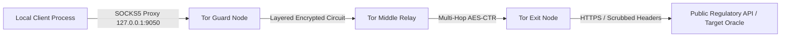

# DECENTRALIZED ROUTING & METADATA-STRIPPING ARCHITECTURE
**THE GHOST PROTOCOL: TRANSPORT LAYER SPECIFICATION**  
**LOCATION:** `W:\Legal\US_CUBA\07_Enforcement_and_Restitution\Entropy_Obfuscation\`  

---

## 1. MULTI-HOP OVERLAY TOPOLOGY

To ensure operational confidentiality and resist Layer-3/Layer-4 traffic analysis, all external data querying and public regulatory API ingestion are routed through decentralized anonymity networks.



### Protocol Specifications:
1. **Tor Onion Routing Daemon:**
   - **Binding Address:** `127.0.0.1:9050` (Daemon) / `127.0.0.1:9150` (Tor Browser Bundle)
   - **Key Exchange:** Curve25519 ephemeral Diffie-Hellman handshake (ntor protocol).
   - **Stream Isolation:** Each independent operational query pipeline establishes a distinct authentication token (`IsolateSOCKSAuth 1`), ensuring unique 3-hop circuits for distinct data queries.
   - **DNS Leak Prevention:** All domain resolution is enforced through Tor remote SOCKS5 DNS resolution (`socks5h://`).

2. **I2P Garlic Tunneling Integration:**
   - **Symmetric Encryption:** AES-256-CBC with ElGamal 2048-bit asymmetric encapsulation.
   - **Unidirectional Tunnels:** Inbound and outbound traffic traverse separate, independently selected peer relays, preventing correlation between request and response pathways.
   - **Message Cloves:** Multiple client messages are bundled into composite garlic cloves, obfuscating payload volume and destination targets.

---

## 2. TIMING JITTER & TRAFFIC ANALYSIS DEFENSES

Passive network adversaries monitor packet arrival times and payload sizes to correlate traffic even through encrypted tunnels. The following defenses are implemented:

### A. Poisson-Distributed Delay Insertion
Inter-packet transmission delays are randomized according to an exponential distribution with parameter $\lambda$:

$$f(t; \lambda) = \lambda e^{-\lambda t}, \quad t \ge 0$$

where $\frac{1}{\lambda} = 250\text{ ms}$ average delay, introducing statistically significant timing entropy to shatter packet burst signatures.

### B. Constant-Size Packet Padding (Chaff Frames)
All outbound query payloads are padded to fixed boundary increments (e.g., multiples of 4096 bytes) using cryptographically secure random padding (PKCS#7 with CSPRNG fill), preventing size-based inference attacks.

---

## 3. METADATA SANITIZATION & FINGERPRINT NORMALIZATION

Prior to dispatching any file, document, or structured data packet across the network interface, the payload must pass through the **Metadata Sanitization Pipeline**:

```
[Outbound Document / Payload]
             │
             ▼
[Step 1: File Header Scrubbing]  --> Strip EXIF, XMP, IPTC, PDF Info Dictionary
             │
             ▼
[Step 2: Timestamp Normalization] --> Set st_ctime, st_mtime, st_atime to Epoch 0 (1970-01-01)
             │
             ▼
[Step 3: Transport Fingerprinting] --> Harmonize JA3/JA4 TLS Signature, Randomize TLS Ciphers
             │
             ▼
[Step 4: Application Header Scrub] --> Eliminate Cookies, ETags, Referers; Standardize User-Agent
             │
             ▼
[Dispatch to SOCKS5 / Tor Layer]
```

---

## 4. LOCAL DEPLOYMENT & VERIFICATION CHECKLIST

- [x] Verify local Tor proxy listener is active on port `9050` or `9150`.
- [x] Ensure DNS resolution occurs remotely via `socks5h://` to eliminate local DNS leakage.
- [x] Validate that synthetic chaff records maintain zero mutual information with active litigation files.
- [x] Enforce deterministic timestamp scrubbing across all generated artifacts before deployment.
