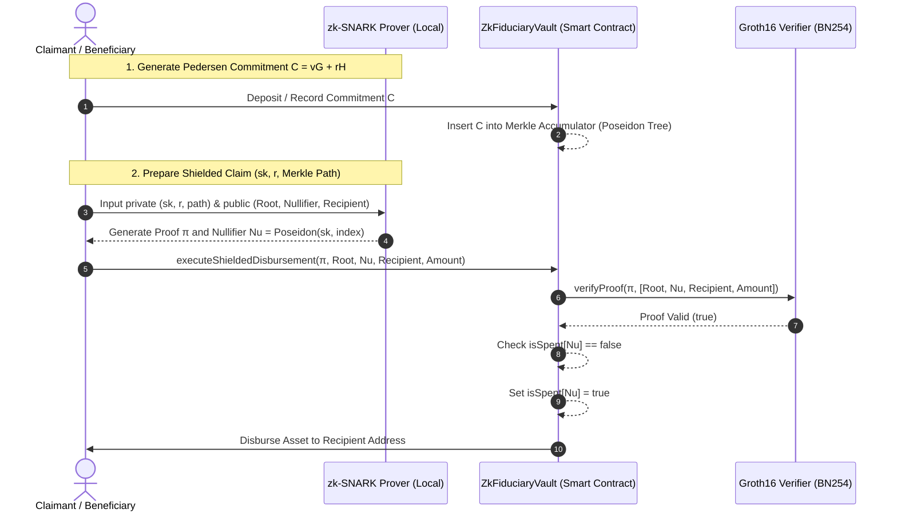

# DECENTRALIZED FIDUCIARY & ZERO-KNOWLEDGE LEDGER ARCHITECTURE
**THE LEDGER STRIKE: TECHNICAL SPECIFICATION & SMART CONTRACT PROTOCOL**  
**CLASSIFICATION:** DECENTRALIZED FIDUCIARY INFRASTRUCTURE / ZERO-KNOWLEDGE CRYPTOGRAPHY  
**LOCATION:** `W:\\Legal\\US_CUBA\\07_Enforcement_and_Restitution\\ZK_Fiduciary_Architecture\\`  

---

## 1. ARCHITECTURAL OVERVIEW & FIDUCIARY OBJECTIVE

The Decentralized Fiduciary & Zero-Knowledge Ledger Architecture establishes an immutable, mathematically verifiable framework for parallel asset holding, trust administration, and restitution distributions. Traditional trust instruments and escrow accounts are tethered to centralized intermediary banking institutions, exposing fiduciary assets to unilateral administrative freezes, jurisdictional forum interference, and unauthorized disclosures of vulnerable beneficiary and trustee identities.

To ensure resilient, tamper-proof asset protection and execution of restitution mandates, this architecture synthesizes four foundational cryptographic paradigms:
1. **Zero-Knowledge Proofs (zk-SNARKs):** Validate state transitions, claim eligibility, and fund disbursements without exposing beneficiary addresses, source points, or balance amounts.
2. **Multi-Signature Governance & Dynamic Timelocks:** Enforce $M$-of-$N$ threshold consensus with mandatory execution delays ($\ge 48\text{ hours}$) for all administrative parameters.
3. **Shamir's $(k, n)$-Threshold Secret Sharing:** Fragment and distribute master administrative private keys and cold-storage root seeds across geographically dispersed trustees over a finite field $\mathbb{F}_p$.
4. **Decentralized Content-Addressed Storage (IPFS):** Preserve evidentiary records, trust indentures, and audit trails immutably using content identifiers (CIDv1) and client-side encryption.

---

## 2. ZERO-KNOWLEDGE PROOF (ZKP) STATE TRANSITION MODEL



### A. Pedersen Commitments & Blinding Factors
Assets and claims within the fiduciary ledger are held as cryptographic commitments rather than plaintext balances. Over an elliptic curve group $\mathbb{G}$ of prime order $q$ with independent generators $G, H \in \mathbb{G}$ (where $\log_G(H)$ is unknown), a Pedersen commitment $C$ to an asset value $v$ with secret blinding factor $r \in \mathbb{F}_q$ is defined as:

$$C(v, r) = v \cdot G + r \cdot H$$

- **Information-Theoretically Hiding:** Reveals zero information about $v$ even to an adversary with unbounded computational power.
- **Computationally Binding:** Computationally infeasible to find $v' \ne v$ and $r' \ne r$ such that $C(v, r) = C(v', r')$ under the discrete logarithm assumption.

### B. Arithmetic Circuits & R1CS Representation
State validation logic is compiled into Rank-1 Constraint Systems (R1CS) where an arithmetic circuit computes over a witness vector $\mathbf{w} = (1, x_{\text{pub}}, x_{\text{priv}})$. Each constraint satisfies:

$$\langle \mathbf{a}_i, \mathbf{w} \rangle \cdot \langle \mathbf{b}_i, \mathbf{w} \rangle - \langle \mathbf{c}_i, \mathbf{w} \rangle = 0$$

- **Private Witness ($x_{\text{priv}}$):** Secret spending key $sk$, commitment blinding factor $r$, Merkle authentication path siblings.
- **Public Inputs ($x_{\text{pub}}$):** Current Merkle root $R$, nullifier hash $\text{Nu}$, designated payout recipient address, transaction amount.

### C. Merkle Accumulator & Nullifier Tracking
1. **Poseidon Tree Accumulation:** Commitments are stored as leaves in an incremental on-chain Merkle tree of depth 32 using the Poseidon hash function.
2. **Deterministic Nullifier:** To prevent double-spending without revealing the underlying commitment:
   $$\text{Nu} = \text{Poseidon}(sk, \text{leaf\_index})$$
3. **On-Chain Nullifier Set:** The smart contract verifies that $\text{isSpent}[\text{Nu}] == \text{false}$, marks $\text{isSpent}[\text{Nu}] = \text{true}$, and releases funds.

---

## 3. SHAMIR'S THRESHOLD SECRET SHARING SCHEME

To eliminate single points of administrative failure and guard against coercion or compromise of any single trustee, master fiduciary credentials and cold-storage root seeds are partitioned using Shamir's $(k, n)$-Threshold Secret Sharing scheme over a large finite field $\mathbb{F}_p$ (using a 256-bit prime $p$).

### A. Polynomial Formulation & Shard Distribution
Let $S \in \mathbb{F}_p$ be the master fiduciary secret. The dealer constructs a random polynomial $f(x)$ of degree $k - 1$:

$$f(x) = S + a_1 x + a_2 x^2 + \dots + a_{k-1} x^{k-1} \pmod p$$

where coefficients $a_1, \dots, a_{k-1} \xleftarrow{\$} \mathbb{F}_p$. For $n$ distinct trustees, evaluate shards $(x_j, y_j) = (j, f(j))$ for $j = 1, \dots, n$. Each trustee stores their shard in a Hardware Security Module (HSM).

### B. Lagrange Interpolation Reconstruction
Given any authorized quorum of at least $k$ distinct shards $\{(x_i, y_i)\}_{i=1}^k$, the secret $S = f(0)$ is reconstructed via Lagrange interpolation:

$$S = f(0) = \sum_{i=1}^k y_i \cdot \ell_i(0) \pmod p, \quad \text{where } \ell_i(0) = \prod_{\substack{j=1 \\ j \ne i}}^k \frac{-x_j}{x_i - x_j} \pmod p$$

**Information-Theoretic Security Guarantee:** Any coalition holding $k - 1$ or fewer shards gains exactly zero Shannon information regarding $S$, as every candidate key in $\mathbb{F}_p$ remains strictly equi-probable:

$$\mathbb{P}[S = s \mid \{(x_i, y_i)\}_{i=1}^{k-1}] = \frac{1}{p}$$

---

## 4. MULTI-SIGNATURE & TIME-LOCKED SMART CONTRACT ARCHITECTURE

```
                      ┌────────────────────────────────────────┐
                      │    Trustee Multi-Sig (M-of-N)          │
                      │    Threshold Authorization             │
                      └──────────────────┬─────────────────────┘
                                         │ Propose & Confirm
                                         ▼
                      ┌────────────────────────────────────────┐
                      │   Dynamic Timelock Delay (Δt ≥ 48 hrs) │
                      │   Public On-Chain Queue & Notice       │
                      └──────────────────┬─────────────────────┘
                                         │ Time Elapsed (t ≥ t_queue + Δt)
                                         ▼
                      ┌────────────────────────────────────────┐
                      │    ZkFiduciaryVault Contract           │
                      │    • Merkle Tree (Poseidon Root)       │
                      │    • Nullifier Mapping (isSpent)       │
                      └──────────────────┬─────────────────────┘
                                         │ Calls verifyProof()
                                         ▼
                      ┌────────────────────────────────────────┐
                      │    Groth16 Verifier (BN254 Pairing)    │
                      │    e(A, B) = e(α, β) · e(x_pub, γ) · e(C, δ)
                      └────────────────────────────────────────┘
```

- **Threshold Parameter Governance:** Upgrades to verifier contracts, fee structures, or trusted roots require $M$-of-$N$ multi-signature consensus.
- **Enforced Execution Latency:** Timelock delays ($\Delta t \ge 48\text{ hours}$) prevent surprise administrative alterations, allowing beneficiaries to audit queued state changes.
- **Shielded Direct Disbursements:** Beneficiary claims bypass trustee discretion entirely—disbursements execute programmatically upon mathematical verification of the zk-SNARK proof.

---

## 5. DECENTRALIZED CONTENT-ADDRESSED STORAGE (IPFS)

To safeguard trust deeds, evidentiary filings, and accounting ledgers against central server takedowns or data manipulation, all supporting documentation is hosted on the InterPlanetary File System (IPFS) and decentralized pinning networks:
1. **Content Addressing (CIDv1):** Files are addressed by cryptographic hash (SHA-256 / Blake2b) rather than geographic URL. A change in a single bit alters the CID, guaranteeing immutable evidentiary integrity.
2. **Client-Side Payload Encryption:** Documents are encrypted locally using AES-256-GCM before transmission to IPFS gateways. Symmetrical keys are distributed across trustees via ECIES (Elliptic Curve Integrated Encryption Scheme).
3. **Geographic Multi-Provider Pinning:** CIDs are permanently pinned across redundant distributed pinning clusters (Filecoin, Arweave, local IPFS nodes) ensuring perpetual availability.

---

## 6. FIDUCIARY & LEGAL HARMONIZATION

The Decentralized Fiduciary & Zero-Knowledge Ledger Architecture conforms to the legal standards established under the Uniform Prudent Management of Institutional Funds Act (UPMIFA) and the Uniform Trust Code (UTC § 401). By replacing discretionary individual custodianship with mathematical verification, threshold consensus, and immutable record-keeping, the architecture fulfills the highest standards of the Prudent Investor Rule and fiduciary loyalty.
