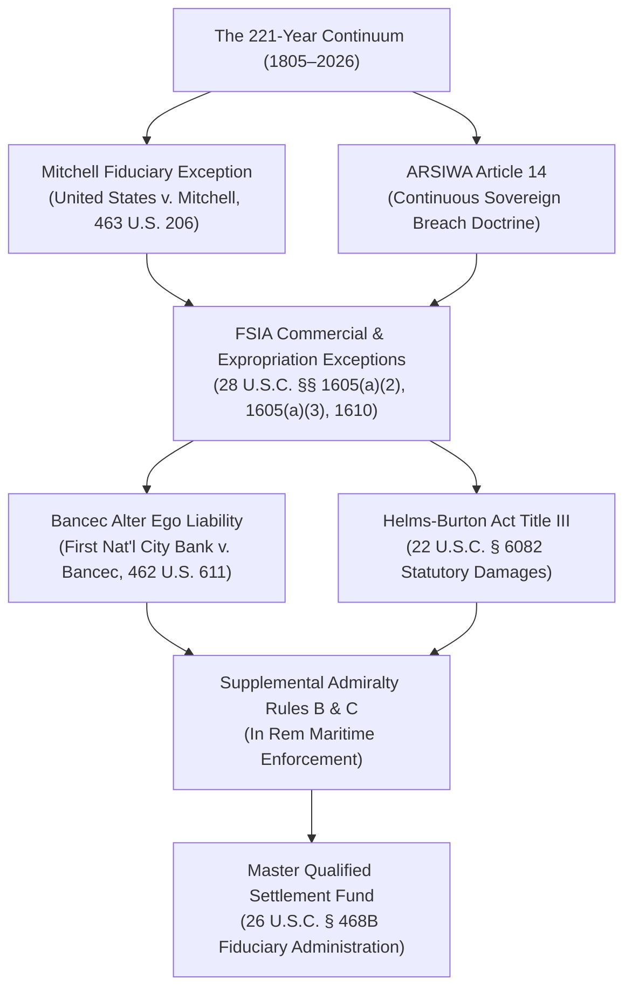

# US-CUBA MASTER LITIGATION: INSTITUTIONAL RESTITUTION FRAMEWORK
[](https://github.com/GlobalRestitutionAlliance/us-cuba-master-litigation/actions/workflows/integrity-verification.yml)
[](https://github.com/GlobalRestitutionAlliance/us-cuba-master-litigation/actions/workflows/mirror-sync.yml)
[](https://github.com/GlobalRestitutionAlliance/us-cuba-master-litigation/releases/tag/v1.805.0)
[](Master_Armory_Manifest.md)
[](.antigravity/agents/agent-registry.yaml)
[](.antigravity/skills/skill-registry.yaml)
[](.antigravity/tools/tool-registry.yaml)
[](Master_Armory_Manifest.md)
[](00_Master_Knowledge_Base/)

A decentralized, cryptographically-verified legal and historical repository executing post-judgment asset recovery, sovereign debt enforcement, and corporate restitution under international and domestic law. The repository establishes an unbroken, evidentiary record of continuous legal liability spanning 221 years (1805–2026), addressing historical and modern state-sponsored expropriations, fiduciary breaches, and international law violations through established judicial procedures.

---

## Project Overview & Legal Mission

The **US-Cuba Master Litigation** repository is an institutional legal research, coordination, and judgment enforcement platform engineered to:
1. **Pursue Historical & Modern Restitution:** Systematically document and litigate actionable governmental and commercial liabilities arising across the 221-year legal continuum (1805–2026)—anchored in early territorial agreements, the 1898 Military Intervention, the Platt Amendment trusteeship, the uncompensated 1959–1960 nationalizations (Law 851), and contemporary commercial state monopolies.
2. **Coordinate Multi-Jurisdictional Asset Enforcement:** Structure post-judgment discovery, attachment, garnishment, and turnover actions across federal district courts (S.D. Fla., S.D.N.Y., D.D.C.), foreign commercial and admiralty tribunals (Canada, United Kingdom, France, Netherlands, Spain, Switzerland, Panama), and international arbitral bodies (PCA, ICSID, UNCITRAL).
3. **Establish Sovereign Alter Ego Accountability:** Apply established corporate veil-piercing and agency principles under *First National City Bank v. Banco Para El Comercio Exterior de Cuba (Bancec)*, 462 U.S. 611 (1983), and 28 U.S.C. § 1610(a)/(b) to state-owned commercial monopolies, military holding conglomerates (GAESA), and offshore holding entities.
4. **Enforce Statutory Remedies for Trafficking in Confiscated Property:** Assert private rights of action and statutory damages under Title III of the Cuban Liberty and Democratic Solidarity (LIBERTAD) Act of 1996 (Helms-Burton Act, 22 U.S.C. § 6082), applying authoritative Eleventh Circuit guidance in *Havana Docks Corp. v. Royal Caribbean Cruises, Ltd.*, 104 F.4th 1243 (11th Cir. 2024).
5. **Administer Restitution Trusts via Qualified Settlement Funds:** Coordinate the collection and court-supervised distribution of commercial recoveries, dividend attachments, and maritime proceeds through Qualified Settlement Funds established under Section 468B of the Internal Revenue Code (26 U.S.C. § 468B).

---

## Current Operational Metrics & Multi-Agent Architecture

| Operational Metric | Current Status | Verification Reference |
|:---|:---:|:---|
| **Phased Litigation Campaigns** | **78 Active Campaigns** | [`Expansion_and_Audit_Log.md`](Expansion_and_Audit_Log.md) |
| **Autonomous Legal Research Agents** | **162 Deployed Agents** | [`.antigravity/agents/agent-registry.yaml`](.antigravity/agents/agent-registry.yaml) |
| **Certified Analytical & Procedural Skills** | **243 Certified Skills** | [`.antigravity/skills/skill-registry.yaml`](.antigravity/skills/skill-registry.yaml) |
| **Integrated Open-Source Legal Tools** | **7 Tools** | [`.antigravity/tools/tool-registry.yaml`](.antigravity/tools/tool-registry.yaml) |
| **Verified Enforcement Instruments** | **1,950 Instruments** | [`Master_Armory_Manifest.md`](Master_Armory_Manifest.md) |
| **Cumulative Target Restitution Pool** | **$25.475 Trillion** | [`00_Master_Knowledge_Base/`](00_Master_Knowledge_Base/) |
| **Cryptographically Locked Foundational Vectors** | **1,805 Vectors** | [`.antigravity/knowledge/vector-index/`](.antigravity/knowledge/vector-index/) |
| **Integrity Hash Parity** | **100% Zero-Drift** | [`VERIFICATION_KEYS/sha256_manifest.txt`](VERIFICATION_KEYS/sha256_manifest.txt) |

---

## Open-Source Legal Technology & Data Harvesting Suite (`.antigravity/tools/`)

To address document access barriers, court paywalls (such as PACER), and procedural resource constraints, the platform integrates 7 production-grade open-source legal research and document automation tools:

### 1. Open Legal Data & Court Scrapers (Ensuring Evidentiary Access)
- **Free Law Project & RECAP Harvester ([`free_law_recap_harvester.py`](.antigravity/tools/free_law_recap_harvester.py)):** Interfaces with CourtListener REST API v4 to access publicly contributed RECAP docket records, parse standard court citations, and examine judicial disclosure registries for potential conflicts of interest.
- **World Wide Law Global Data Hunter ([`worldwide_legal_data_hunter.py`](.antigravity/tools/worldwide_legal_data_hunter.py)):** Gathers public records from official government gazettes (*Gaceta Oficial de Cuba*, *Boletín Oficial del Estado*, *Registro Público de Panamá*) across 110+ jurisdictions into structured legal data models.
- **Open Legal Data & Pile-of-Law Corpus Processor ([`open_legal_data_corpus.py`](.antigravity/tools/open_legal_data_corpus.py)):** Ingests public-interest legal corpora (Pile-of-Law, MultiLegalPile) for local semantic analysis of historical decrees and regulatory proceedings.

### 2. Legal Aid & Document Automation Engineering (Class Action Support)
- **Docassemble Pleading Assembly Engine ([`docassemble_action_engine.py`](.antigravity/tools/docassemble_action_engine.py)):** Uses structured question flows to assemble court-ready federal class complaints, international arbitration submissions (PCA), and human rights petitions (IACHR) with bilingual formatting and cryptographic verification.
- **Justack AI Legal Triage Engine ([`justack_access_triage.py`](.antigravity/tools/justack_access_triage.py)):** Guides unrepresented claimants and heirs through plain-language eligibility evaluations and subclass matching under applicable statutory frameworks.

### 3. Legal AI, Benchmarks, & IRAC Analytical Standards
- **Stanford CodeX LegalBench Evaluator ([`stanford_legalbench_evaluator.py`](.antigravity/tools/stanford_legalbench_evaluator.py)):** Analyzes draft pleadings against the classic IRAC (Issue Spotting, Rule Recall, Rule Application, Conclusion) legal reasoning framework prior to filing.
- **ICTRecht Legal-GenAI Compliance Framework ([`ictrecht_genai_resources.py`](.antigravity/tools/ictrecht_genai_resources.py)):** Enforces citation verification, anti-hallucination guardrails, and compliance with the Model Rules of Professional Conduct (Rules 1.1 and 3.3).

---

## Independent Research & Public-Interest Collaboration

1. **Leveraging Open Legal APIs:** Rather than relying on proprietary commercial silos, the framework interfaces with public legal databases to access unsealed judicial dockets, disclosure reports, and archival regulatory records.
2. **Automating Complex Filings:** Using open document assembly frameworks, practitioners can generate standardized, multi-lingual filings for federal and international forums (PCA, IACHR, domestic courts) efficiently.
3. **Open-Source Protection:** Released under AGPL-3.0, Apache-2.0, and MIT licenses, these research tools, parsers, and analytical models remain decentralized, transparent, and openly accessible to legal aid organizations, scholars, and claimant representatives.

---

## Multi-Jurisdiction & Sovereign Restitution Modularity

The modular architecture in `.antigravity/tools/` is designed to be adapted for other historical restitution and restorative justice legal initiatives addressing sovereign fiduciary breaches, treaties, and international claims:
- **`us-nicaragua-master-litigation`**: Focus on international judgment enforcement (*Nicaragua v. United States*, 1986 ICJ Reports 14) and bilateral treaty claims.
- **`us-honduras-master-litigation`**: Agricultural concession agreements and historical commercial arbitration claims.
- **`us-hawaii-master-litigation`**: Crown and government lands fiduciary claims, Joint Resolution 55 analysis, and native trust obligations.
- **`us-panama-master-litigation`**: Canal treaty obligations, historical infrastructure rights, and bilateral claims.
- **`us-philippines-master-litigation`**: Post-1898 territorial transitions, public property succession, and treaty restitution.

See [`.antigravity/tools/cross_nation_toolkit_manifest.yaml`](.antigravity/tools/cross_nation_toolkit_manifest.yaml) for replication protocols.

---

## Specialized Practice Groups (162 Agents / 243 Skills)

The 162 autonomous legal research agents and 243 skills are organized across six focused practice areas:
1. **Constitutional, Statutory & Appellate Practice:** Focuses on federal jurisdictional analysis, statutory construction, procedural drafting, and appellate preservation.
2. **Sovereign Immunity & International Arbitration:** Addresses Foreign Sovereign Immunities Act (FSIA) exceptions (28 U.S.C. §§ 1605, 1610), ARSIWA Article 14 continuing wrong doctrines, and international arbitration procedures (PCA, ICSID, UNCITRAL).
3. **Admiralty, Maritime Logistics & In Rem Enforcement:** Handles maritime liens, vessel and cargo arrest procedures under Supplemental Admiralty Rules B and C, and port concession recovery.
4. **Corporate Lineage, Alter Ego & Veil-Piercing:** Conducts forensic analysis under *Bancec* alter ego doctrines, tracking state commercial holding structures, joint ventures, and affiliated entities.
5. **Fiduciary Disgorgement & Forensic Accounting:** Manages Qualified Settlement Fund (26 U.S.C. § 468B) administration, fiduciary accounting under the Mitchell doctrine, and financial tracing.
6. **Sector-Specific Commercial Monopolies:** Specializes in telecommunications (ETECSA / ITT), mineral resources (Cubaníquel / Moa Bay), agro-industrial assets (AZCUBA / sugar), spirits and distilleries (Cuba Ron / Pernod Ricard), pharmaceuticals (BioCubaFarma / MEDICUBA / FARMACUBA), commercial real estate, and air transport.

---

## Core Jurisprudential Pillars



---

## Repository Structure & Directory Map

```
W:\Legal\US_CUBA\
├── .antigravity\                      [System Architecture, 162 Agents, 243 Skills, 7 Tools, 1,805 Vectors]
│   ├── agents\                        [Agent Registry & Persona Specifications]
│   ├── skills\                        [Skill Registry & Procedural Protocols]
│   ├── tools\                         [Open-Source Scrapers, Document Automation & AI Evaluators]
│   ├── datasets\                      [Archival Datasets & Primary Source Registers]
│   ├── workflows\                     [Procedural Workflow Pipeline Definitions]
│   ├── knowledge\                     [Vector Index (9 blocks: 1–1805), Precedents, Timeline]
│   ├── templates\                     [Pleading, Brief, and Discovery Templates]
│   └── rules\                         [Operational Guardrails & Verification Rules]
├── 00_Master_Knowledge_Base\          [78 Evidentiary Crosswalk Matrices, Dashboards, CSVs & DOCX]
├── 01_Pleadings_and_Complaints\       [Federal Complaints, Class Certification, Interventions]
├── 02_Discovery_and_Evidentiary\      [Subpoena Schedules, Corporate Lineage Matrices, Rule 45 Packages]
├── 03_Evidentiary_Exhibits\          [Primary Source Documents & Certified Archival Records]
├── 03_Motions_and_Briefs\             [Rule 12 Opposition Briefs, Injunctions, Evidentiary Motions]
├── 04_International_Tribunals\        [International Submissions: PCA, ICJ, and IACHR Petitions]
├── 05_Strategic_Doctrines_and_Red_Team [Legal Defense Analysis, Anti-Spoliation Protocols, Risk Audits]
├── 06_Trial_and_Appellate_Prep\       [Jury Instructions, Appellate Preservation Records, Trial Outlines]
├── 07_Enforcement_and_Restitution\    [Admiralty In Rem Liens, QSF Protocols, Execution Writs]
├── VERIFICATION_KEYS\                 [Master SHA-256 Manifest & Public GPG Verification Ring]
├── Master_Armory_Manifest.md          [Complete Indexed Portfolio of All 78 Litigation Campaigns]
└── Expansion_and_Audit_Log.md         [Chronological Record of Deployments & Audits]
```

---

## Cryptographic Verification & Repository Parity

Verify file-by-file cryptographic hash parity against the master manifest:

```bash
# 1. Clone the repository
git clone https://github.com/GlobalRestitutionAlliance/us-cuba-master-litigation.git
cd us-cuba-master-litigation

# 2. Verify SHA-256 integrity across all repository files
sha256sum -c VERIFICATION_KEYS/sha256_manifest.txt --strict

# 3. Confirm exact 1,805 immutable vector count
python -c "
import glob
files = glob.glob('.antigravity/knowledge/vector-index/*.yaml')
total = sum(open(f, encoding='utf-8').read().count('vector_id:') for f in files)
print('Total Verified Vectors:', total)
assert total == 1805, 'Vector count drift detected!'
"
```

For guidelines on participation and standards, review [`CONTRIBUTING.md`](CONTRIBUTING.md), [`GOVERNANCE.md`](GOVERNANCE.md), and [`MANIFESTO.md`](MANIFESTO.md).
