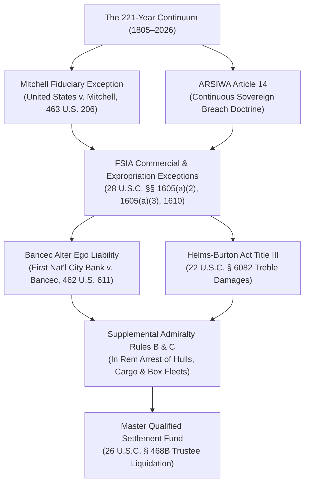

# US-CUBA MASTER LITIGATION: GLOBAL RESTITUTION WAR ROOM
[](https://github.com/GlobalRestitutionAlliance/us-cuba-master-litigation/actions/workflows/integrity-verification.yml)
[](https://github.com/GlobalRestitutionAlliance/us-cuba-master-litigation/actions/workflows/mirror-sync.yml)
[](https://github.com/GlobalRestitutionAlliance/us-cuba-master-litigation/releases/tag/v1.805.0)
[](Master_Armory_Manifest.md)
[](.antigravity/agents/agent-registry.yaml)
[](.antigravity/skills/skill-registry.yaml)
[](Master_Armory_Manifest.md)
[](00_Master_Knowledge_Base/)

An offensive jurisprudential warfare command, institutional litigation war room, and cryptographically verified legal repository executing global post-judgment asset enforcement, sovereign debt execution, and corporate disgorgement. The repository establishes an unbroken, evidentiary chain of continuous legal liability spanning 221 years (1805–2026), dismantling sovereign immunity for historic and modern state-sponsored expropriations, colonial subjugation, and uncurable fiduciary breaches.

---

## What This Project Is

The **US-Cuba Master Litigation** repository is an operationalized legal-technological weapon system and multi-jurisdictional judgment enforcement war room engineered to:
1. **Enforce Historical & Modern Restitution:** Systematically prosecute uncurable governmental and commercial liabilities arising from the 221-year continuum (1805–2026)—anchored in the foundational 1805 Louisiana-Florida border incursions, the 1898 Military Occupation, the Platt Amendment trusteeship, the uncompensated 1959–1960 nationalizations (Law 851), and modern state commercial monopolies.
2. **Execute Multi-Jurisdictional Asset Arrests:** Coordinate post-judgment attachment, garnishment, and turnover actions across federal district courts (S.D. Fla., S.D.N.Y., D.D.C.), foreign commercial and admiralty tribunals (Canada, UK, France, Netherlands, Spain, Switzerland, Panama), and international arbitral forums (PCA, ICSID, UNCITRAL).
3. **Pierce Sovereign Alter Ego Veils:** Apply the Supreme Court doctrine of *First National City Bank v. Banco Para El Comercio Exterior de Cuba (Bancec)*, 462 U.S. 611 (1983), and 28 U.S.C. § 1610(a)/(b) to penetrate state-owned enterprises, military holding conglomerates (GAESA), and offshore front companies as alter egos of the Cuban sovereign state.
4. **Disgorge Transnational Trafficking Proceeds:** Assert statutory private rights of action and treble damages under Title III of the Cuban Liberty and Democratic Solidarity (LIBERTAD) Act of 1996 (Helms-Burton Act, 22 U.S.C. § 6082), reinforced by Eleventh Circuit precedent in *Havana Docks Corp. v. Royal Caribbean Cruises, Ltd.*, 104 F.4th 1243 (11th Cir. 2024).
5. **Manage Restitution via Qualified Settlement Funds:** Consolidate seized commercial revenues, dividend flows, debt garnishments, and maritime sale proceeds into judicially supervised Master Qualified Settlement Funds under Section 468B of the Internal Revenue Code (26 U.S.C. § 468B).

---

## Current Operational Metrics & Swarm Architecture

| Operational Metric | Armory Status | Verification Reference |
|:---|:---:|:---|
| **Phased Swarm Campaigns Executed** | **56 Campaigns** | [`Expansion_and_Audit_Log.md`](Expansion_and_Audit_Log.md) |
| **Autonomous Swarm Enforcement Agents** | **118 Agents** | [`.antigravity/agents/agent-registry.yaml`](.antigravity/agents/agent-registry.yaml) |
| **Certified Tactical Enforcement Skills** | **177 Skills** | [`.antigravity/skills/skill-registry.yaml`](.antigravity/skills/skill-registry.yaml) |
| **Armed Multi-Theater Tactical Instruments** | **1,400 Instruments** | [`Master_Armory_Manifest.md`](Master_Armory_Manifest.md) |
| **Cumulative Target Restitution Pool** | **$17.710 Trillion** | [`00_Master_Knowledge_Base/`](00_Master_Knowledge_Base/) |
| **Cryptographically Locked Foundational Vectors** | **1,805 Vectors** | [`.antigravity/knowledge/vector-index/`](.antigravity/knowledge/vector-index/) |
| **Integrity Hash Parity** | **100% Zero-Drift** | [`VERIFICATION_KEYS/sha256_manifest.txt`](VERIFICATION_KEYS/sha256_manifest.txt) |

---

## Tactical Command Divisions (118 Agents / 177 Skills)

The 118 autonomous agents and 177 certified skills operate across six specialized commands:
1. **Constitutional, Statutory & Supreme Court Warfare:** Lead Strategic Counsel, Procedural Blacksmith, SCOTUS Advocate, Class Action Drafters, and Pretrial Strategists.
2. **Sovereign Immunity & International Arbitration:** FSIA Specialists (28 U.S.C. §§ 1605, 1610), ARSIWA Article 14 Continuing Wrongs Envoys, ICJ/PCA Arbitrators, and UN Treaty Delegates.
3. **Admiralty, Maritime Logistics & Fleet Arrest:** Consignataria Mambisa Port Auditors, Melfi Marine Container Fleets, Prácticos Pilotage Garnishees, Canadian Maritime Marshals, and Supplemental Admiralty Rules B & C Enforcement Officers.
4. **Corporate Lineage, Alter Ego & Veil-Piercing:** *Bancec* Alter Ego Harvesters, GAESA Commercial Network Monitors, Transnational Joint Venture Marshals, and Offshore Shell Company Liquidators.
5. **Fiduciary Disgorgement & Forensic Accounting:** Mitchell Fiduciary Trustees, QSF Receivers (26 U.S.C. § 468B), Intermediary Bank Clearing Garnishees, and Forensic Financial Economists.
6. **Sovereign Monopolies & Industrial Restitution:** Sector-specific teams targeting Telecommunications (ETECSA / ITT), Nickel Mining (Cubaníquel / Sherritt), Sugar Agro-Industrial (AZCUBA), Rum & Distilleries (Cuba Ron / Pernod Ricard), Pharmaceuticals (BioCubaFarma / MEDICUBA / FARMACUBA), Commercial Real Estate (Inmobiliaria Monte Barreto), and Air Cargo (Aerovaradero).

---

## Core Jurisprudential Pillars



1. **The Mitchell Fiduciary Exception:** Establishes non-discretionary federal statutory trusteeship and perpetual accountability for sovereign expropriations without compensation (*United States v. Mitchell*, 463 U.S. 206).
2. **ARSIWA Article 14 (Continuing Wrongs):** Codifies that continuing breaches of international law extending from historical acts into the present establish active, unextinguished sovereign liability.
3. **Foreign Sovereign Immunities Act (FSIA):** 28 U.S.C. § 1605(a)(2) (Commercial Activity), § 1605(a)(3) (Takings in Violation of International Law), § 1605(b) (Maritime Liens), and § 1610 (Post-Judgment Attachment and Execution of Sovereign Commercial Assets).
4. **Bancec Alter Ego Doctrine:** Pierces separate juridical status when state corporate entities are abused to perpetrate fraud or evade statutory restitution (*First National City Bank v. Bancec*, 462 U.S. 611).
5. **Supplemental Admiralty Rules B & C:** Authorizes worldwide maritime attachment, garnishment, and in rem arrest of commercial vessels, subsea cables, freight revenues, and containerized cargo.

---

## Repository Structure & Directory Map

```
W:\Legal\US_CUBA\
├── .antigravity\                      [Swarm Engine, 118 Agents, 177 Skills, 1,805 Vectors]
│   ├── agents\                        [Agent Registry & Persona Specifications]
│   ├── skills\                        [Skill Registry & Operational Protocols]
│   ├── datasets\                      [Archival Datasets & NARA/LOC Muniments]
│   ├── workflows\                     [Multi-Agent Pipeline Definitions]
│   ├── knowledge\                     [Vector Index (9 blocks: 1–1805), Precedents, Timeline]
│   ├── templates\                     [Federal Pleading & Motion Templates]
│   └── rules\                         [Swarm Operational Rules & Guardrails]
├── 00_Master_Knowledge_Base\          [56 Crosswalk Matrices, Dashboards, Master CSVs & DOCX]
├── 01_Pleadings_and_Complaints\       [Federal Court Complaints, Class Certification, Interventions]
├── 02_Discovery_and_Evidentiary\      [Subpoena Schedules, Corporate Lineage Matrices, Rule 45 Packages]
├── 03_Evidentiary_Exhibits\          [Primary Source PDFs & Immutable Ledger Muniments]
├── 03_Motions_and_Briefs\             [Rule 12 Oppositions, Injunctions, Evidentiary Motions]
├── 04_International_Tribunals\        [UNGA Draft Resolutions, ICJ Petitions, UNCITRAL Demands]
├── 05_Strategic_Doctrines_and_Red_Team [Sun Tzu Counter-Moves, Centurion Dossiers, Anti-Spoliation]
├── 06_Trial_and_Appellate_Prep\       [Jury Instructions, Appellate Records, Pretrial Outlines]
├── 07_Enforcement_and_Restitution\    [Admiralty In Rem Liens, QSF Protocols, Execution Writs]
├── VERIFICATION_KEYS\                 [Master SHA-256 Manifest & Public GPG Ring]
├── Master_Armory_Manifest.md          [Complete Indexed Armory of All 56 Campaigns]
└── Expansion_and_Audit_Log.md         [Chronological Execution & Audit Log of Swarm Deployments]
```

---

## Quick Start & Cryptographic Verification

Clone the repository and verify file-by-file cryptographic hash parity against the master manifest:

```bash
# 1. Clone the repository
git clone https://github.com/GlobalRestitutionAlliance/us-cuba-master-litigation.git
cd us-cuba-master-litigation

# 2. Verify SHA-256 integrity across all repository files
sha256sum -c VERIFICATION_KEYS/sha256_manifest.txt --strict

# 3. Confirm exact 1,805 immutable vector count
python -c "
import glob
files = glob.glob('.antigravity/knowledge/vector-index/*.yaml')
total = sum(open(f, encoding='utf-8').read().count('vector_id:') for f in files)
print('Total Verified Vectors:', total)
assert total == 1805, 'Vector count drift detected!'
"
```

For participation guidelines, review [`CONTRIBUTING.md`](CONTRIBUTING.md), [`GOVERNANCE.md`](GOVERNANCE.md), and [`MANIFESTO.md`](MANIFESTO.md).
